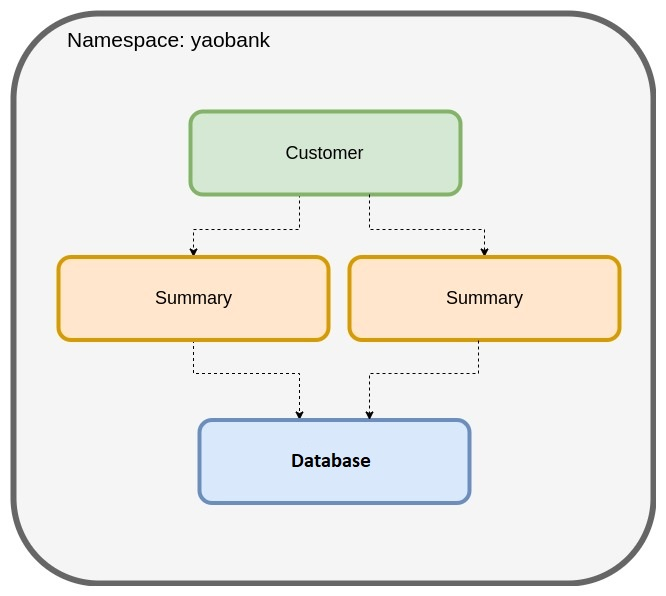
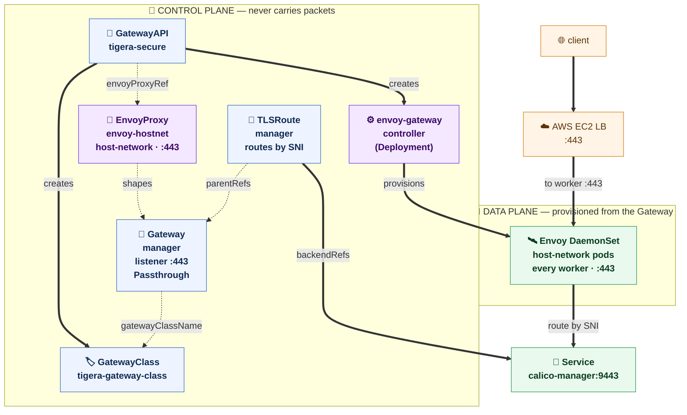
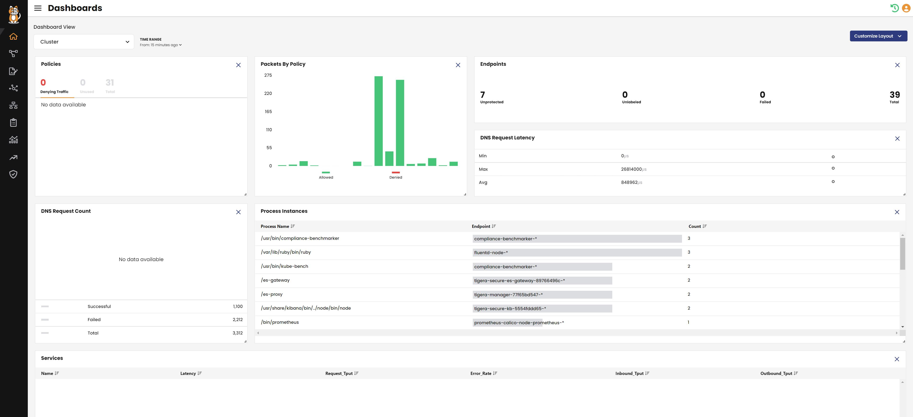
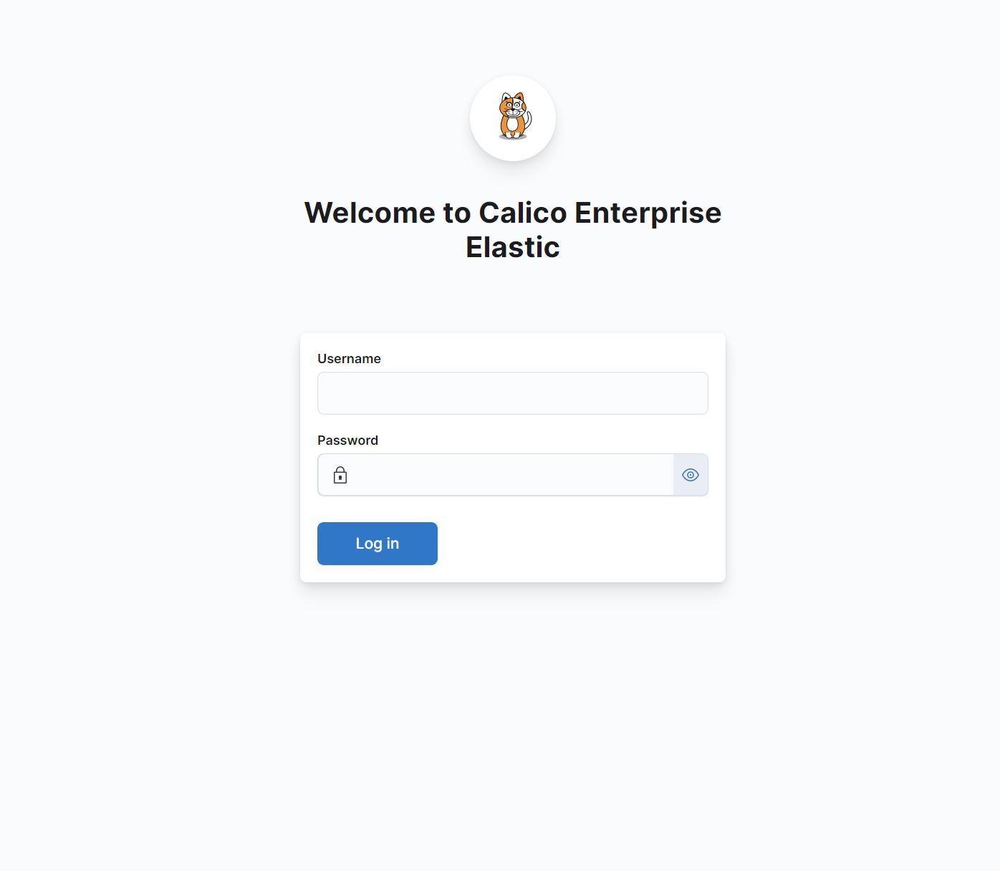

# In this lab

This lab provides the instructions to:

* [Overview](#overview)
* [Install Calico Enterprise](#install-calico-enterprise)
* [Install Calico Enterprise command line utility "calicoctl"](#install-calico-enterprise-command-line-utility-calicoctl)
* [Deploy a three-tier sample application called "yaobank" (Yet Another Online Bank)](#deploy-a-three-tier-sample-application-called-yaobank-yet-another-online-bank)
* [Enable Calico Ingress Gateway in host-network mode](#enable-calico-ingress-gateway-in-host-network-mode)
* [Access CE Manager UI using Ingress](#access-ce-manager-ui-using-ingress)


### Overview

Container Network Interface is an initiative from the Cloud-Native Computing Foundation. It is a set of interface standards that define how the container runtime engine (docker, cri-o, containerd, others) and the cni plugin work together to dynamically connect a pod to the network. Kubernetes defines the specification of the network model, but the actual implementation of the network model is abstracted from Kubernetes and Kubernetes uses the CNI for that. Upstream Kubernetes by default does not provide a network interface plugin. In this lab, we will walk through the process of installing Calico Enterprise as the CNI and security policy provider.

**Lab environment.** The commands in this lab are run from a **bastion** host (where `kubectl`, `calicoctl`, and `oc` are available). The cluster has one **control-plane node** (`control1`, `10.0.1.20`) and two **worker nodes**, all in AWS. Two things are pre-provisioned for you and referenced in later sections: an external **AWS EC2 load balancer** that fronts the worker nodes on port 443, and a wildcard **DNS** record `*.<LABNAME>.training.tigera.ca` pointing at it — that is how you reach the Manager UI once ingress is configured. Replace `<LABNAME>` with your lab instance name wherever it appears.


_______________________________________________________________________________________________________________________________________________________________________

### Install Calico Enterprise

 In this lab environment, Kubernetes has been preinstalled, but as your network plugin is not installed yet your nodes will appear as NotReady. This section walks you through the required steps to install Calico Enteprise as both the CNI provider and network policy engine provider.

#### Set the Calico Enterprise version

Throughout this section you will download several Calico Enterprise manifests, and each manifest URL includes the product version. Rather than hardcoding the version in every command, set it once as an environment variable now. Every `kubectl create`/`curl` command below references `${CE_VERSION}`, so you can retarget the whole install at a different release by changing this single value.

```
export CE_VERSION=v3.23.1
```

> **Note:** Set `CE_VERSION` to the Calico Enterprise version your lab targets (this guide uses `v3.23.1`). Run the remaining commands in this section in the **same shell session** so the variable stays in scope. Confirm it is set before continuing:
>
> ```
> echo $CE_VERSION
> ```

#### Enable kubectl autocompletion

Before getting started, let's enable bash autocomplete for kubectl so that we can easier interact with kubectl.

```
sudo apt-get install bash-completion
source /usr/share/bash-completion/bash_completion
echo 'source <(kubectl completion bash)' >>~/.bashrc
source ~/.bashrc

```

#### Verify the nodes are NotReady

To validate that the CNI plugin is not installed in this cluster, run the following command. All the cluster nodes' STATUS should appear as NotReady.

```
kubectl get nodes
```
```
NAME                                      STATUS     ROLES                  AGE     VERSION
ip-10-0-1-20.eu-west-1.compute.internal   NotReady   control-plane,master   2m21s   v1.23.14
ip-10-0-1-30.eu-west-1.compute.internal   NotReady   <none>                 117s    v1.23.14
ip-10-0-1-31.eu-west-1.compute.internal   NotReady   <none>                 117s    v1.23.14
```

#### Create persistent storage for Elasticsearch

Calico Enterprise uses ElasticSearch to store various logs such as flowlogs, DNS logs, and all others that it collects over the network. ElasticSearch requires persistent storage to store the data. This lab uses host path storage provisioner, which is not suitable for production enviroment and can result in scalability issues, instability, and data loss.

```
kubectl apply -f - <<EOF
apiVersion: storage.k8s.io/v1
kind: StorageClass
metadata:
  name: tigera-elasticsearch
provisioner: kubernetes.io/no-provisioner
volumeBindingMode: WaitForFirstConsumer
---
apiVersion: v1
kind: PersistentVolume
metadata:
  name: tigera-elasticsearch
spec:
  capacity:
    storage: 10Gi
  accessModes:
    - ReadWriteOnce
  hostPath:
    path: /var/tigera/elastic-data/1
  persistentVolumeReclaimPolicy: Recycle
  storageClassName: tigera-elasticsearch
EOF

```

#### Verify the StorageClass

Make sure the StorageClass has been created successfully.

```
kubectl get storageclass
```
```
NAME                   PROVISIONER                    RECLAIMPOLICY   VOLUMEBINDINGMODE      ALLOWVOLUMEEXPANSION   AGE
tigera-elasticsearch   kubernetes.io/no-provisioner   Delete          WaitForFirstConsumer   false                  25s
```

#### Install the Tigera Operator CRDs and operator

The Tigera Operator is a Kubernetes operator and provides a well-defined API for how you install, configure, and run Calico Enterprise. Tigera operator also automates and controls the the lifecycle of a Calico Enterprise deployment. In current releases the operator's custom resource definitions (CRDs) ship in a separate manifest that must be applied **first**, before the operator itself. Get yourself familiar with the content of the manifests and create them in the cluster.

First install the operator CRDs:

```
kubectl create -f https://downloads.tigera.io/ee/${CE_VERSION}/manifests/operator-crds.yaml
```

Then install the Tigera Operator. The operator manifest configures the necessary resources such as namespaces, service accounts, clusterroles, etc, so that the cluster is ready to deploy other Calico Enterprise components.

```
kubectl create -f https://downloads.tigera.io/ee/${CE_VERSION}/manifests/tigera-operator.yaml
```

#### Verify the Tigera Operator is running

Validate that the tigera-operator is running in the cluster. Note that the tigera-operator is running even though there is no CNI plugin deployed in the cluster. This is because tigera-operator is host networked meaning that it uses the host IP address to communicate over the network.

```
kubectl get pods -n tigera-operator -o wide
```

```
NAME                               READY   STATUS    RESTARTS   AGE   IP          NODE                                      NOMINATED NODE   READINESS GATES
tigera-operator-74575475cc-t5hkp   1/1     Running   0          10s   10.0.1.30   ip-10-0-1-30.eu-west-1.compute.internal   <none>           <none>
```

#### Install the Prometheus operator

Calico Enterprise Manager UI uses Prometheus to provide out-of-the-box metrics in the various sections of CE Manager UI such as the dashboard page, security policies, and others. Calico Enterprise uses Prometheus operator to deploy Prometheus server and Alertmanager. Apply the following manifest to deploy the Prometheus operator.

  **Note:** Prometheus operator that ships with Calico Enterprise is an optional component and can be replaced with the customer's Prometheus operator if needed.   However, a Prometheus operator must be deployed in the cluster and watch the "tigera-prometheus" namespace to deploy the required Prometheus and Alertmanager   resources. Customer's instance of Prometheus operator can be deployed in any namesapce.


```
kubectl create -f https://downloads.tigera.io/ee/${CE_VERSION}/manifests/tigera-prometheus-operator.yaml
```

#### Check the Prometheus operator pod status

```
kubectl get pods -n tigera-prometheus
```
```
NAME                                          READY   STATUS    RESTARTS   AGE
calico-prometheus-operator-6557c5bc57-6l2l8   0/1     Pending   0          7s
```

#### Understand why the Prometheus operator is Pending

tigera-prometheus operator should be in the Pending STATUS. Let's run the following command and check the `Events:` section of the pod. As indicated in the Warning message, the pod is not running because two nodes have the taint "node.kubernetes.io/not-ready". The reason for this taint is because the CNI plugin is not running in this cluster yet.

```
kubectl describe pods -n tigera-prometheus
```

```
Events:
  Type     Reason            Age   From               Message
  ----     ------            ----  ----               -------
  Warning  FailedScheduling  18s   default-scheduler  0/3 nodes are available: 1 node(s) had taint {node-role.kubernetes.io/master: }, that the pod didn't tolerate, 2 node(s) had taint {node.kubernetes.io/not-ready: }, that the pod didn't tolerate.
```

#### Create the image pull secret

This lab directly downloads the images from quay.io/tigera, which requires authentication. Run the following command to create the secret necessary to pull the images.

```
kubectl create secret generic tigera-pull-secret \
    --from-file=.dockerconfigjson=/home/tigera/config.json \
    --type=kubernetes.io/dockerconfigjson -n tigera-operator
```

#### Inspect the calico-system namespace

tigera-operator uses custom resouces to deploy the required resources for Calico Enterprise. For example, tigera-operator creates all the the pods in the calico-system namesapce and a number of other resources when it sees the Installation resource in the cluster.

Run the following command to see if there is any resources in the calico-system namesapce. You should see none.

```
kubectl get all -n calico-system
```

Installation resouce is also responsible for certain install time configuration parameters such as IPPOOL configuration, MTU, and etc. For complete info on the Installation resource configurations, please visit the following link.

https://docs.tigera.io/reference/installation/api#operator.tigera.io/v1.Installation

We have customized the installation resource for this lab. We have defined an IPPOOL with the CIDR 10.48.0.0/24. This must be within the range of the pod network CIDR when Kubernetes is bootstrapped. Here we are defining a smaller subnet within the available range as we will be creating additional pools for other purposes in subsequent labs.

#### Find the cluster pod and service CIDRs

Run the following command to find the cluster-cidr (pod-network-cidr) that was used to bootstrap the cluster. You should have a similar output provided below.

```
kubectl cluster-info dump | grep -m 2 -E "service-cluster-ip-range|cluster-cidr"
```
```
$ kubectl cluster-info dump | grep -m 2 -E "service-cluster-ip-range|cluster-cidr"
                            "--service-cluster-ip-range=10.49.0.0/16",
                            "--cluster-cidr=10.48.0.0/16"
```

#### Create the Installation resource to enable the CNI

Now apply the following manifest, which will create the the Installation custom resource and enables the CNI functionality in the cluster.

```
kubectl apply -f -<<EOF
# This section includes base Calico installation configuration.
# For more information, see: https://docs.projectcalico.org/v3.21/reference/installation/api#operator.tigera.io/v1.Installation
apiVersion: operator.tigera.io/v1
kind: Installation
metadata:
  name: default
spec:
  # Install Calico Enterprise
  variant: TigeraSecureEnterprise
  # List of image pull secrets to use when installing images from a container registry.
  # If specified, secrets must be created in the `tigera-operator` namespace.
  imagePullSecrets:
    - name: tigera-pull-secret
  calicoNetwork:
    # Note: The ipPools section cannot be modified post-install.
    ipPools:
    - blockSize: 26
      cidr: 10.48.0.0/24
      encapsulation: None
      natOutgoing: Enabled
      nodeSelector: all()
EOF

```

#### Install the Calico Enterprise custom resources

Get yourself familiar with the resources in the following manifest and then install the Calico Enterprise custom resources.

  **Note:** We have already customized and deployed the Installation custom resource, which is also available in the following manifest. However, since there is no customization in the following manifest, there is no change in the Installation resource configuration. We will just receive a message that the resource already exist.

```
kubectl create -f https://downloads.tigera.io/ee/${CE_VERSION}/manifests/custom-resources.yaml
```

#### Watch the Calico Enterprise components come up

Watch the status of various components progressing. We need to wait for at least one of the tigera-apiserver pods in the tigera-system namespace to be running before applying the tigera licensekey in the next step. The reasons is that the LicenseKey resource uses "projectcalico.org/v3" api, which is managed by the tigera apiserver.

```
watch kubectl get pods -A
```
```
Every 2.0s: kubectl get pods -A                                                                                                                                                                                                                                                                                                         bastion: Wed Dec 28 23:50:12 2022

NAMESPACE              NAME                                                                 READY   STATUS      RESTARTS      AGE
calico-system          calico-apiserver-5b85c9c6d5-jfg6r                                    2/2     Running     0             47m
calico-system          calico-apiserver-5b85c9c6d5-n8bwp                                    2/2     Running     0             47m
calico-system          calico-kube-controllers-5995f8549-nc6jc                              1/1     Running     0             47m
calico-system          calico-node-65p9z                                                    1/1     Running     0             47m
calico-system          calico-node-h9jdg                                                    1/1     Running     0             47m
calico-system          calico-node-jt22q                                                    1/1     Running     0             47m
calico-system          calico-typha-865cb87958-7pkz4                                        1/1     Running     0             47m
calico-system          calico-typha-865cb87958-mmh4j                                        1/1     Running     0             47m
calico-system          csi-node-driver-bpxf7                                                2/2     Running     0             47m
calico-system          csi-node-driver-tbsxg                                                2/2     Running     0             47m
calico-system          csi-node-driver-xldp2                                                2/2     Running     0             47m
calico-system          es-calico-kube-controllers-59b5956dd4-x6htq                          1/1     Running     0             6m13s
kube-system            coredns-548d977cdd-4m6tk                                             1/1     Running     0             85m
kube-system            coredns-548d977cdd-vhml8                                             1/1     Running     0             85m
kube-system            etcd-ip-10-0-1-20.eu-west-1.compute.internal                      1/1     Running     0             85m
kube-system            kube-apiserver-ip-10-0-1-20.eu-west-1.compute.internal            1/1     Running     0             85m
kube-system            kube-controller-manager-ip-10-0-1-20.eu-west-1.compute.internal   1/1     Running     0             85m
kube-system            kube-proxy-cs4c7                                                     1/1     Running     0             85m
kube-system            kube-proxy-jvzt5                                                     1/1     Running     0             85m
kube-system            kube-proxy-qkqqq                                                     1/1     Running     0             85m
kube-system            kube-scheduler-ip-10-0-1-20.eu-west-1.compute.internal            1/1     Running     0             85m
tigera-eck-operator    elastic-operator-0                                                   1/1     Running     0             9m43s
tigera-elasticsearch   dashboards-installer-llvp2                                           0/1     Completed   0             5m58s
tigera-elasticsearch   tigera-elasticsearch-metrics-f96d79d99-985qj                         1/1     Running     0             5m55s
tigera-elasticsearch   tigera-linseed-694b8f8dc8-bvlsn                                      1/1     Running     0             6m3s
tigera-elasticsearch   tigera-linseed-694b8f8dc8-gmrnq                                      1/1     Running     0             6m3s
tigera-elasticsearch   tigera-secure-es-44nsw7g5tmm5-0                                      1/1     Running     0             9m38s
tigera-elasticsearch   tigera-secure-es-gateway-68f64fdb5f-msq2z                            1/1     Running     0             6m49s
tigera-elasticsearch   tigera-secure-es-gateway-68f64fdb5f-wl2jb                            1/1     Running     0             6m49s
tigera-kibana          tigera-secure-kb-667c47d7f8-7hg98                                    1/1     Running     0             9m37s
tigera-kibana          tigera-secure-kb-667c47d7f8-j2jpv                                    1/1     Running     0             9m37s
tigera-operator        tigera-operator-7dcc7bdd7-8w2fl                                      1/1     Running     0             62m
tigera-prometheus      calico-prometheus-operator-f8c8cb45c-8pgss                           1/1     Running     0             100s

```
Alternatively, you could use the following command to watch the status of various Calico Enteprise components progress.

```
watch kubectl get tigerastatus
```
```
Every 2.0s: kubectl get tigerastatus                                                                                                                                                                                                                                                                                                    bastion: Wed Dec 28 23:57:31 2022

NAME                  AVAILABLE   PROGRESSING   DEGRADED   SINCE
apiserver             True        False         False      7m48s
calico                True        False         False      8m43s
compliance                                      True
intrusion-detection                             True
log-collector                                   True
log-storage                                     True
manager                                         True
monitor               True        False         False      7m53s
```

#### Apply the Calico Enterprise license

Apply the LicenseKey to unblock enterprise features of Calico Enterprise.

```
kubectl create -f /home/tigera/license.yaml
```

#### Confirm all components are Available

Watch the status of various components progressing. Ensure that all the components are AVAILABLE and there is no components in PROGRESSING or DEGRADED status before moving forward. This can take few minutes.

```
watch kubectl get tigerastatus
```

You should see an output similar to the following, which denotes Calico Enterprise is fully deployed in the cluster.
```
NAME                          AVAILABLE   PROGRESSING   DEGRADED   SINCE   MESSAGE
apiserver                     True        False         False      2m55s   All objects available
calico                        True        False         False      27m     All objects available
intrusion-detection           True        False         False      2m15s   All objects available
ippools                       True        False         False      2m50s   All objects available
log-collector                 True        False         False      90s     All objects available
log-storage                   True        False         False      28m     All objects available
log-storage-access            True        False         False      23m     All objects available
log-storage-dashboards        True        False         False      23m     All objects available
log-storage-elastic           True        False         False      23m     All objects available
log-storage-esmetrics         True        False         False      23m     All objects available
log-storage-kubecontrollers   True        False         False      24m     All objects available
log-storage-secrets           True        False         False      65m     All objects available
manager                       True        False         False      100s    All objects available
monitor                       True        False         False      2m20s   All objects available
policy-recommendation         True        False         False      2m15s   All objects available
tiers                         True        False         False      3m5s    All objects available
```

_______________________________________________________________________________________________________________________________________________________________________


### Install Calico Enterprise command line utility "calicoctl"

calicoctl is the Calico Enterprise specific command line utility that allows you to create, read, update, and delete Calico Enterprise objects from the command line.

#### Download the calicoctl binary

Download the calicoctl binary for Linux and make it executable. As with the install manifests, the download URL is versioned, so it reuses the `${CE_VERSION}` environment variable you set at the start of this lab (re-export it with `export CE_VERSION=v3.23.1` if you have since opened a new shell).

```
curl -o calicoctl -L https://downloads.tigera.io/ee/binaries/${CE_VERSION}/calicoctl
chmod +x calicoctl
```

> **Reference:** [Install calicoctl as a binary on a single host](https://docs.tigera.io/calico-enterprise/latest/operations/clis/calicoctl/install#install-calicoctl-as-a-binary-on-a-single-host).

#### Move calicoctl into your PATH

Move the executable into a directory on your `PATH` so you can run it from anywhere.

```
sudo mv calicoctl /usr/local/bin
```

#### Verify the calicoctl version matches the cluster

We also need to make sure the `Cluster Calico Enterprise Version` matches the calicoctl version in `Client Version`. Otherwise please raise this to your instructor.

```
calicoctl version
```
```
Client Version:    v3.23.1-calient-0.dev-88-gfb99b157539b
Release:           Calico Enterprise
Git commit:        fb99b157539ba123c3785e411a8113733a551736
Cluster Calico Version:               v3.32.0
Cluster Calico Enterprise Version:    v3.23.1
Cluster Type:                         typha,kdd,k8s,operator,bgp,kubeadm
```

_______________________________________________________________________________________________________________________________________________________________________

### Deploy a three-tier sample application called "yaobank" (Yet Another Online Bank)

yaobank is a sample application, which consists of 3 microservices explained below. It will be used throughout the training for various demonstrations.

* Customer (provides a simple web GUI)
* Summary (provides some middleware business logic)
* Database (peovides the persistent datastore for the bank)


The following diagram shows the logical diagram of the application.



#### Deploy the yaobank application

Install the application by applying the following manifest in the cluster.

```
kubectl apply -f -<<EOF
---
apiVersion: v1
kind: Namespace
metadata:
  name: yaobank
  labels:
    istio-injection: disabled

---
apiVersion: v1
kind: Service
metadata:
  name: database
  namespace: yaobank
  labels:
    app: database
spec:
  ports:
  - port: 2379
    name: http
  selector:
    app: database

---
apiVersion: v1
kind: ServiceAccount
metadata:
  name: database
  namespace: yaobank
  labels:
    app: yaobank

---
apiVersion: apps/v1
kind: Deployment
metadata:
  name: database
  namespace: yaobank
spec:
  selector:
    matchLabels:
      app: database
      version: v1
  replicas: 1
  template:
    metadata:
      labels:
        app: database
        version: v1
    spec:
      serviceAccountName: database
      containers:
      - name: database
        image: calico/yaobank-database:certification
        imagePullPolicy: IfNotPresent
        ports:
        - containerPort: 2379
        command: ["etcd"]
        args:
          - "-advertise-client-urls"
          - "http://database:2379"
          - "-listen-client-urls"
          - "http://0.0.0.0:2379"

---
apiVersion: v1
kind: Service
metadata:
  name: summary
  namespace: yaobank
  labels:
    app: summary
spec:
  ports:
  - port: 80
    name: http
  selector:
    app: summary
    
---
apiVersion: v1
kind: ServiceAccount
metadata:
  name: summary
  namespace: yaobank
  labels:
    app: yaobank
    database: reader
    
---
apiVersion: apps/v1
kind: Deployment
metadata:
  name: summary
  namespace: yaobank
spec:
  replicas: 2
  selector:
    matchLabels:
      app: summary
      version: v1
  template:
    metadata:
      labels:
        app: summary
        version: v1
    spec:
      serviceAccountName: summary
      containers:
      - name: summary
        image: calico/yaobank-summary:certification
        imagePullPolicy: Always
        ports:
        - containerPort: 80
 
---
apiVersion: v1
kind: Service
metadata:
  name: customer
  namespace: yaobank
  labels:
    app: customer
spec:
  type: NodePort
  ports:
  - port: 80
    nodePort: 30180
    name: http
  selector:
    app: customer
    
---
apiVersion: v1
kind: ServiceAccount
metadata:
  name: customer
  namespace: yaobank
  labels:
    app: yaobank
    summary: reader
    
---
apiVersion: apps/v1
kind: Deployment
metadata:
  name: customer
  namespace: yaobank
spec:
  replicas: 1
  selector:
    matchLabels:
      app: customer
      version: v1
  template:
    metadata:
      labels:
        app: customer
        version: v1
    spec:
      serviceAccountName: customer
      containers:
      - name: customer
        image: calico/yaobank-customer:certification
        imagePullPolicy: Always
        ports:
        - containerPort: 80
---
EOF

```

#### Verify the yaobank pods are running

Check the status of the pods. Make sure all the pods are in Running status.

```
watch kubectl get pods -n yaobank -o wide
```
```
NAME                        READY   STATUS    RESTARTS   AGE   IP            NODE                                      NOMINATED NODE   READINESS GATES
customer-687b8d8f74-lmzqz   1/1     Running   0          38s   10.48.0.20    ip-10-0-1-31.eu-west-1.compute.internal   <none>           <none>
database-545f6d6d95-khwr2   1/1     Running   0          38s   10.48.0.19    ip-10-0-1-31.eu-west-1.compute.internal   <none>           <none>
summary-7579bd9566-866km    1/1     Running   0          38s   10.48.0.21    ip-10-0-1-31.eu-west-1.compute.internal   <none>           <none>
summary-7579bd9566-cj4v4    1/1     Running   0          38s   10.48.0.205   ip-10-0-1-30.eu-west-1.compute.internal   <none>           <none>
```

#### Access yaobank through its NodePort

For now, the application we deployed is only accesible from outside the cluster through a NodePort. We can try the following port on any of the cluster nodes to access the customer pod, which is the frontend app. Following is trying the NodePort on the master node.

**Note:** You need to ssh in the `control1` node first by running `ssh control1`.

```
ssh control1

```

```
curl 10.0.1.20:30180

```
```
<!DOCTYPE html PUBLIC "-//W3C//DTD XHTML 1.0 Transitional//EN"
  "http://www.w3.org/TR/xhtml1/DTD/xhtml1-transitional.dtd">

<html xmlns="http://www.w3.org/1999/xhtml">
  <head>
    <title>YAO Bank</title>
    <style>
    h2 {
      font-family: Arial, Helvetica, sans-serif;
    }
    h1 {
      font-family: Arial, Helvetica, sans-serif;
    }
    p {
      font-family: Arial, Helvetica, sans-serif;
    }
    </style>
  </head>
  <body>
        <h1>Welcome to YAO Bank</h1>
        <h2>Name: Spike Curtis</h2>
        <h2>Balance: 2389.45</h2>
        <p><a href="/logout">Log Out >></a></p>
  </body>
</html>
```


_______________________________________________________________________________________________________________________________________________________________________


### Enable Calico Ingress Gateway in host-network mode


Calico Ingress Gateway (CIG) is Calico Enterprise's hardened build of **Envoy Gateway**, driven entirely by the Kubernetes **Gateway API**. Enabling it is a chain of resources: some you create, some are created for you, and each one triggers the next thing to appear. This intro shows the whole chain first so the individual steps make sense.

**Two planes**

CIG is built from two independent halves. The **control plane decides how traffic should be handled**; the **data plane actually handles it**. Every resource you create in this lab is an instruction consumed by the control plane — knowing which half reacts to each object is the whole workflow in a nutshell:

* **Control plane — the `envoy-gateway` controller** (a `Deployment` in `tigera-gateway`). It *watches* every Gateway API object (`GatewayClass`, `Gateway`, `HTTPRoute`, `TLSRoute`) and the `EnvoyProxy` object, translates them into Envoy configuration, and **creates and manages the data-plane workloads**. It never touches customer traffic. It appears once, the moment you apply the `GatewayAPI` CR.

* **Data plane — the Envoy proxy pods** the controller provisions each time you create a `Gateway` (`gateway.networking.k8s.io/v1`). These pods are the **only** component that terminates the socket and forwards packets; the `Gateway`, `HTTPRoute`, and `TLSRoute` objects are just declarative config the controller programs into them.


**The GatewayClass**

A `GatewayClass` is the cluster-scoped **implementation** a `Gateway` selects by name (via `gatewayClassName`) — much like a `StorageClass` is selected by a `PersistentVolumeClaim`. It names the controller that handles it (`gateway.envoyproxy.io/gatewayclass-controller`) and, for CIG, links to the `EnvoyProxy` that shapes the data plane. 

**The resources**

| Resource (`kind`) | API group | What it declares | Who creates it |
|---|---|---|---|
| `EnvoyProxy` | `gateway.envoyproxy.io/v1alpha1` | **How** the data-plane Envoy is deployed — here: host-network, worker-only, ports bound on the host | You |
| `GatewayAPI` | `operator.tigera.io/v1` | Turns the Gateway API on and links a `GatewayClass` name → an `EnvoyProxy` + a `gatewayKind` (`DaemonSet`/`Deployment`) | You — once per cluster |
| `GatewayClass` | `gateway.networking.k8s.io/v1` | The ingress "class" (like a `StorageClass`); `tigera-gateway-class` | Operator, from `GatewayAPI` |
| `Gateway` | `gateway.networking.k8s.io/v1` | **Where** traffic enters: listeners (port, protocol, TLS mode). Creating one makes the controller provision the data plane | You |
| `HTTPRoute` / `TLSRoute` | `gateway.networking.k8s.io/v1` | **How** traffic is routed: attaches to a `Gateway` (`parentRefs`) → forwards to a `Service` (`backendRefs`) | You |
| backend `Service` | `v1` | The workload receiving traffic (e.g. `calico-manager`) | Already exists |

**What gets created, when, and where**

This is the operational sequence — each row is a step in the lab, and the middle column is what materializes as a result:

| You apply | What appears as a result | Kind | Namespace |
|---|---|---|---|
| 1. `Namespace` `tigera-gateway` | the namespace itself | `Namespace` | (cluster-scoped) |
| 2. `EnvoyProxy` `envoy-hostnet` | **nothing runs** — config only; consumed later | `EnvoyProxy` CR | `tigera-gateway` |
| 3. `GatewayAPI` `tigera-secure` | **control plane** → the `envoy-gateway` controller **+** the `GatewayClass` `tigera-gateway-class` | `Deployment` / `GatewayClass` | `tigera-gateway` / cluster-scoped |
| 4. `Gateway` `manager` | **data plane** → `envoy-tigera-gateway-manager-<hash>` **`DaemonSet` + `Service` + bootstrap `ConfigMap`**; Envoy pods land on worker nodes, bind `:443` | `DaemonSet`, `Service`, `ConfigMap` | `tigera-gateway` |
| 5. `TLSRoute` `manager` | **no new workload** — controller pushes the SNI routing rule into the running Envoy; the `Gateway` listener's `attachedRoutes` → `1` | `TLSRoute` CR | `calico-system` |

Steps 1–3 are this section; steps 4–5 come later, in [Access CE Manager UI using Ingress](#access-ce-manager-ui-using-ingress), when you actually expose a workload.

**Why this order**

* **`EnvoyProxy` before `GatewayAPI`.** The `GatewayClass` the operator creates points at the `EnvoyProxy` via `envoyProxyRef`; it only reports `Accepted=True` once that `EnvoyProxy` already exists. Create it first and the class comes up clean.
* **Namespace by hand.** The operator won't create `tigera-gateway` until the `EnvoyProxy` reference resolves, so you create it manually up front.
* **Data plane is lazy.** No Envoy pod exists until a `Gateway` is created — the controller provisions one set of data-plane workloads per `Gateway`. **Host-network mode** is not a global switch; it is simply the result of the `GatewayClass` pointing at *this* custom `EnvoyProxy`.




#### Create the tigera-gateway namespace

Create the `tigera-gateway` namespace. (Create it manually — the operator won't create it until the `EnvoyProxy` reference below resolves.)

```
kubectl create namespace tigera-gateway

```

#### Create the host-network EnvoyProxy

Create the `EnvoyProxy` that runs Envoy as a host-network DaemonSet. `useListenerPortAsContainerPort: true` makes the Gateway's listener ports (80/443) bind directly on the node, and `NET_BIND_SERVICE` allows binding the privileged ports — so Envoy can listen on **443** for traffic forwarded by the AWS EC2 load balancer.

> **Note:** Because of how this lab environment is set up, Calico Ingress Gateway (Envoy Gateway) is deployed in **host-network mode**. Most of the instructions in this section apply equally to Calico Ingress Gateway deployed in **pod-network mode**; the main difference is how the Envoy data plane is exposed to the outside (listener ports bound directly on the nodes versus a Service fronted by a load balancer). For the full set of deployment options, see [Create an ingress gateway](https://docs.tigera.io/calico-enterprise/latest/networking/ingress-gateway/create-ingress-gateway) in the Calico Enterprise documentation.

> **Note:** In this lab environment the gateway must run on the **worker nodes only**, so the DaemonSet patch adds a `nodeSelector` for the `node-role.kubernetes.io/worker` label. The control-plane node does not carry that label (and also has a `node-role.kubernetes.io/control-plane:NoSchedule` taint the DaemonSet does not tolerate), so no Envoy pod is scheduled there.

```
kubectl apply -f - <<EOF
apiVersion: gateway.envoyproxy.io/v1alpha1
kind: EnvoyProxy
metadata:
  name: envoy-hostnet
  namespace: tigera-gateway
spec:
  provider:
    type: Kubernetes
    kubernetes:
      useListenerPortAsContainerPort: true
      envoyDaemonSet:
        patch:
          type: StrategicMerge
          value:
            spec:
              template:
                spec:
                  hostNetwork: true
                  dnsPolicy: ClusterFirstWithHostNet
                  # Run the Envoy data-plane DaemonSet on worker nodes only.
                  nodeSelector:
                    node-role.kubernetes.io/worker: ""
                  containers:
                  - name: envoy
                    securityContext:
                      runAsUser: 0
                      runAsGroup: 0
                      runAsNonRoot: false
                      allowPrivilegeEscalation: true
                      capabilities:
                        add: ["NET_BIND_SERVICE"]
EOF
```

**What this deploys:** nothing runs yet — `EnvoyProxy` is only a configuration object describing *how* the data-plane Envoy should be deployed. The `GatewayClass` references it, and its DaemonSet patch is applied only once a `Gateway` is created. Validate it:


```
# Confirm the EnvoyProxy config object exists:
kubectl -n tigera-gateway get envoyproxy envoy-hostnet
```

#### Enable the Gateway API and bind the GatewayClass

Enable the Gateway API and bind `tigera-gateway-class` to that `EnvoyProxy`, telling CIG to provision it as a `DaemonSet`.

```
kubectl apply -f - <<EOF
apiVersion: operator.tigera.io/v1
kind: GatewayAPI
metadata:
  name: tigera-secure
spec:
  gatewayClasses:
  - name: tigera-gateway-class
    gatewayKind: DaemonSet           # must match the kind chosen above
    envoyProxyRef:
      namespace: tigera-gateway
      name: envoy-hostnet
EOF

```

**What this deploys:** applying the `GatewayAPI` CR makes the Tigera operator (1) roll out the **Envoy Gateway controller** (`envoy-gateway` Deployment) in `tigera-gateway`, and (2) create the **`GatewayClass`** `tigera-gateway-class`. This is the control plane — there is still no data-plane Envoy until you create a `Gateway`. Validate what it produced:

```
# The operator CR you just applied:
kubectl get gatewayapi tigera-secure

# (1) The Envoy Gateway CONTROLLER the operator rolled out. This Deployment watches every
#     Gateway / HTTPRoute / TLSRoute object and translates them into Envoy configuration:
kubectl -n tigera-gateway get deploy envoy-gateway

# (2) The GatewayClass the operator created from the GatewayAPI CR (confirmed in the next step):
kubectl get gatewayclass tigera-gateway-class

# Still only the control plane at this point — the controller pod runs, but there is no
# Envoy data-plane DaemonSet yet (it appears when you create a Gateway):
kubectl -n tigera-gateway get pods
```

#### Confirm the GatewayClass is accepted

Confirm the GatewayClass is accepted (`ACCEPTED` should be `True`). This is the signal that the operator wired the class to your `EnvoyProxy` successfully.

```
kubectl get gatewayclass

```

```
NAME                   CONTROLLER                                      ACCEPTED   AGE
tigera-gateway-class   gateway.envoyproxy.io/gatewayclass-controller   True       30s
```


_______________________________________________________________________________________________________________________________________________________________________


### Access CE Manager UI using Ingress

In this section we expose the Calico Enterprise Manager UI so you can reach it from your browser, using **Calico Ingress Gateway** (the Gateway API). This is steps 4–5 of the chain introduced in [Enable Calico Ingress Gateway in host-network mode](#enable-calico-ingress-gateway-in-host-network-mode): the control plane (`envoy-gateway` controller) already runs, so here you add the two config objects that make it provision and program the data plane — first the `Gateway` (the listener), then the `TLSRoute` (the routing rule that attaches to it).

The `Gateway` and `TLSRoute` are **only declarative config** — they are not themselves the thing routing traffic. When you apply them, the controller reacts by provisioning/updating the Envoy `DaemonSet`, and it is those Envoy pods (on the workers, bound to `:443`) that actually route the connections. Externally, the AWS EC2 load balancer forwards port 443 to those worker nodes.

The Manager UI terminates its own TLS and handles token-based auth, so we use **TLS passthrough**: Envoy routes by SNI and forwards the still-encrypted connection straight to the Manager — no certificate is configured on the Gateway. This is the host-network-on-443 equivalent of the nginx ingress used previously.

#### Create the passthrough Gateway

The `Gateway` defines the entry point: a TLS listener on port **443** in `Passthrough` mode, served by the worker-node Envoy DaemonSet. The listener `hostname` is intentionally left commented out so the listener accepts any SNI and the `TLSRoute` does the routing — see the note below.

```
kubectl apply -f -<<EOF
apiVersion: gateway.networking.k8s.io/v1
kind: Gateway
metadata:
  name: manager
  namespace: tigera-gateway
spec:
  gatewayClassName: tigera-gateway-class
  listeners:
  - name: https
    protocol: TLS
    port: 443
    # hostname: "manager.<LABNAME>.training.tigera.ca"   # optional listener filter — see note below
    tls:
      mode: Passthrough
    allowedRoutes:
      kinds:
      - kind: TLSRoute
      namespaces:
        from: All
EOF

```

> **Note — why the listener `hostname` is commented out.** The listener `hostname` is only a *filter*: it restricts which server names (SNIs) the listener serves, and therefore which routes may attach. It is **optional**. Left out (as here), the listener accepts **any** SNI and the actual routing is done entirely by the `TLSRoute`'s `hostnames` — so you can attach several `TLSRoute`s to this one Gateway, each matching a different hostname, and Envoy demultiplexes them by SNI. Uncomment it (or set a wildcard such as `"*.<LABNAME>.training.tigera.ca"`) only if you want to *scope* this listener to a single hostname or subdomain.
>
> This enables **hostname/SNI-based** routing only. With TLS **passthrough** the connection stays encrypted end to end, so Envoy cannot read the HTTP path or headers — **path/header-based routing is not possible here**. That would require terminating TLS at the Gateway (`mode: Terminate` + a certificate) and using an `HTTPRoute`, as shown in the [Calico Ingress Gateway](../6.%20Calico%20Ingress%20Gateway) lab.

**What this deploys:** creating the `Gateway` makes the controller provision the **data plane** for the first time — an Envoy `DaemonSet` (`envoy-tigera-gateway-manager-…`) plus a backing `Service` and a bootstrap `ConfigMap`. Its pods run on the **worker nodes** on the host network, binding `:443`. Verify the Gateway and its pods:

```
# The Gateway object and its status. NOTE: in host-network mode the top-level PROGRAMMED
# column may show False because no external ADDRESS is assigned — that is expected here.
# The real "is it up?" check is the per-listener status further below.
kubectl -n tigera-gateway get gateway manager

# The data plane the controller provisioned FROM this Gateway — a DaemonSet, a Service, and a
# bootstrap ConfigMap, all named envoy-tigera-gateway-manager-<hash>:
kubectl -n tigera-gateway get ds,svc,configmap -l gateway.envoyproxy.io/owning-gateway-name=manager

# The Envoy data-plane pods — they must be Running on the WORKER nodes, with pod IP == node IP
# (host network) and none on the control-plane node:
kubectl -n tigera-gateway get pods -o wide -l gateway.envoyproxy.io/owning-gateway-name=manager

# Confirm the listener itself is programmed (the reliable readiness check in host-network mode):
kubectl -n tigera-gateway get gateway manager -o jsonpath='listener {.status.listeners[0].name}: programmed={.status.listeners[0].conditions[?(@.type=="Programmed")].status}{"\n"}'
```

The two Envoy pods should be `Running` on the worker nodes, with each pod IP equal to its node IP (host network). Envoy Gateway also creates a `LoadBalancer` Service for the Gateway; its `EXTERNAL-IP` stays `<pending>` and is unused here, because traffic reaches Envoy directly on the host network via the AWS load balancer.

#### Create the TLSRoute to the Manager UI

The `TLSRoute` is the routing rule: it attaches to the Gateway's `https` listener (via `parentRefs`) and forwards traffic for the Manager UI hostname to the backend Service. Replace `<LABNAME>` with the name of your lab instance — it **must match** the Gateway listener hostname above.

> **Note:** The backend is the `calico-manager` Service in the `calico-system` namespace (port `9443`, HTTPS). The `tigera-manager` Service used by the old nginx manifest is only an `ExternalName` alias to it, and an `ExternalName` Service cannot be used as a Gateway API `backendRef`. Placing the `TLSRoute` in `calico-system` (the same namespace as the backend Service) avoids needing a `ReferenceGrant`.

```
kubectl apply -f -<<EOF
apiVersion: gateway.networking.k8s.io/v1
kind: TLSRoute
metadata:
  name: manager
  namespace: calico-system
spec:
  parentRefs:
  - name: manager
    namespace: tigera-gateway
    sectionName: https
  hostnames:
  - "manager.<LABNAME>.training.tigera.ca"
  rules:
  - backendRefs:
    - name: calico-manager
      port: 9443
EOF

```

**What this deploys:** no new pods — a `TLSRoute` adds no workload. It *programs* the existing Envoy data plane with the SNI-based rule that forwards `manager.<LABNAME>…` to `calico-manager:9443`. You can tell it took effect because the Gateway listener's `attachedRoutes` becomes `1` and the route reports `Accepted`. Verify:

```
# The TLSRoute object:
kubectl -n calico-system get tlsroute manager

# Its status — the route must be Accepted by the Gateway, and its backendRefs must resolve
# (ResolvedRefs=True means the calico-manager Service was found). Both should print True:
kubectl -n calico-system get tlsroute manager -o jsonpath='Accepted={.status.parents[0].conditions[?(@.type=="Accepted")].status}  ResolvedRefs={.status.parents[0].conditions[?(@.type=="ResolvedRefs")].status}{"\n"}'

# From the Gateway side, the listener now reports 1 attached route — proof the route bound to it:
kubectl -n tigera-gateway get gateway manager -o jsonpath='listener {.status.listeners[0].name}: attachedRoutes={.status.listeners[0].attachedRoutes}{"\n"}'
```

#### Check access to the Manager UI URL

Check your access to the CE Manager UI using the following URL. Make sure to replace `<LABNAME>` with the name of your lab instance. (yaobank is not exposed through the gateway in this lab — you reach it on its NodePort, as shown earlier.)

```
https://manager.<LABNAME>.training.tigera.ca
```

#### Create a service account for Manager UI login

Calico Enterprise Manager UI by default supports token-based auth. Let's create a serviceaccount so that we can use the associated token to log into the Manager UI.

```
kubectl create sa tigercub
```

#### Grant the service account admin permissions

We already created the serviceaccount, but the serviceaccount does not yet have the required permissions to log into the Manager UI. When CE is deployed, it creates a clusterrole called `tigera-network-admin`, which has full permissions to CE resources including the Manager UI. Let's bind our serviceaccount `tigercub` to the clusterrole `tigera-network-admin` using a clusterrolebinding.

```
kubectl create clusterrolebinding tigercub-bind --clusterrole tigera-network-admin --serviceaccount default:tigercub
```

#### Generate a login token

Run the following command to create a token for the serviceaccount we just created. Copy the token where you can easily retrieve it later.

```
kubectl create token tigercub --duration=24h
```

#### Log in to the Manager UI

Access the Manager UI by browsing to the following URL and paste your token into token field.

**Note:** Do not foroget to replace `<LABNAME>` with your lab instance name.

```
https://manager.<LABNAME>.training.tigera.ca
```
You shouls see a page similar to the following.



#### Retrieve the Kibana password

Calico Enterprise by default installs Kibana, which provides visualization for the data stored in ElasticSearch. To access Kibana, you will use the default `elastic` username. In order to retrieve the password, execute the following command. Store the passsword where you can retrieve it later for subsequent labs.

```
kubectl -n tigera-elasticsearch get secret tigera-secure-es-elastic-user -o go-template='{{.data.elastic | base64decode}}' && echo
```

#### Log in to Kibana

Open Kibana login page by clicking on the Kibana icon on the Manager UI navigation bar on the left side of your browser page. You should a page similar to the following. Insert your username and password.



> **Congratulations! You have completed `1. Install Calico Enterprise` lab.**
