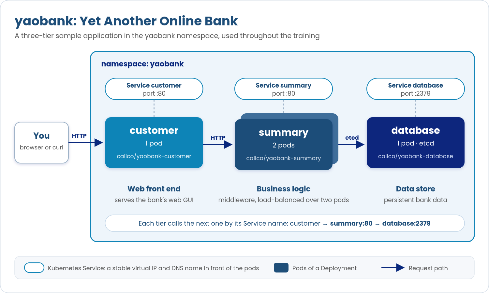

# Module 1: Install Calico Enterprise

## In this lab

This lab provides the instructions to:

* [Overview](#overview)
* [Install Calico Enterprise](#install-calico-enterprise)
* [Install Calico Enterprise command line utility "calicoctl"](#install-calico-enterprise-command-line-utility-calicoctl)
* [Deploy a three-tier sample application called "yaobank" (Yet Another Online Bank)](#deploy-a-three-tier-sample-application-called-yaobank-yet-another-online-bank)

---

## Overview

Container Network Interface is an initiative from the Cloud-Native Computing Foundation. It is a set of interface standards that define how the container runtime engine (docker, cri-o, containerd, others) and the cni plugin work together to dynamically connect a pod to the network. Kubernetes defines the specification of the network model, but the actual implementation of the network model is abstracted from Kubernetes and Kubernetes uses the CNI for that. Upstream Kubernetes by default does not provide a network interface plugin. In this lab, we will walk through the process of installing Calico Enterprise as the CNI and security policy provider.

**Lab environment.** The commands in this lab are run from a **bastion** host (where `kubectl`, `calicoctl`, and `oc` are available). The cluster has one **control-plane node** (`control1`, `10.0.1.20`) and two **worker nodes**, all in AWS. Two things are pre-provisioned for you and referenced in later sections: an external **AWS EC2 load balancer** that fronts the worker nodes on port 443, and a wildcard **DNS** record `*.<LABNAME>.training.tigera.ca` pointing at it — that is how you follow the Calico Ingress Gateway training labs. Replace `<LABNAME>` with your lab instance name wherever it appears.

---

## Install Calico Enterprise

In this lab environment, Kubernetes has been preinstalled, but as your network plugin is not installed yet your nodes will appear as NotReady. This section walks you through the required steps to install Calico Enterprise as both the CNI provider and network policy engine provider.

### 1. Set the Calico Enterprise version

Throughout this section you will download several Calico Enterprise manifests, and each manifest URL includes the product version. Rather than hardcoding the version in every command, set it once as an environment variable now. Every `kubectl create`/`curl` command below references `${CE_VERSION}`, so you can retarget the whole install at a different release by changing this single value.

```bash
export CE_VERSION=v3.24.0-2.0
```

> [!NOTE]
> Set `CE_VERSION` to the Calico Enterprise version your lab targets. Run the remaining commands in this section in the **same shell session** so the variable stays in scope. Confirm it is set before continuing:

```bash
echo $CE_VERSION
```

### 2. Enable kubectl autocompletion

Before getting started, let's enable bash autocomplete for kubectl so that we can easier interact with kubectl.

```bash
sudo apt-get install bash-completion
source /usr/share/bash-completion/bash_completion
echo 'source <(kubectl completion bash)' >>~/.bashrc
source ~/.bashrc
```

### 3. Verify the nodes are NotReady

To validate that the CNI plugin is not installed in this cluster, run the following command. All the cluster nodes' STATUS should appear as NotReady.

```bash
kubectl get nodes
```

**Example output:**

```text
NAME                                      STATUS     ROLES                  AGE     VERSION
ip-10-0-1-20.eu-west-1.compute.internal   NotReady   control-plane,master   2m21s   v1.23.14
ip-10-0-1-30.eu-west-1.compute.internal   NotReady   <none>                 117s    v1.23.14
ip-10-0-1-31.eu-west-1.compute.internal   NotReady   <none>                 117s    v1.23.14
```

### 4. Create persistent storage for Elasticsearch

Calico Enterprise uses ElasticSearch to store various logs such as flowlogs, DNS logs, and all others that it collects over the network. ElasticSearch requires persistent storage to store the data. For the sake of simplicity, this lab uses host path storage provisioner, which is not suitable for production environment and can result in scalability issues, instability, and data loss.

```yaml
kubectl apply -f - <<EOF
apiVersion: storage.k8s.io/v1
kind: StorageClass
metadata:
  name: tigera-elasticsearch
provisioner: kubernetes.io/no-provisioner
volumeBindingMode: WaitForFirstConsumer
---
apiVersion: v1
kind: PersistentVolume
metadata:
  name: tigera-elasticsearch
spec:
  capacity:
    storage: 10Gi
  accessModes:
    - ReadWriteOnce
  hostPath:
    path: /var/tigera/elastic-data/1
  persistentVolumeReclaimPolicy: Recycle
  storageClassName: tigera-elasticsearch
EOF
```

### 5. Verify the StorageClass

Make sure the StorageClass has been created successfully.

```bash
kubectl get storageclass
```

**Example output:**

```text
NAME                   PROVISIONER                    RECLAIMPOLICY   VOLUMEBINDINGMODE      ALLOWVOLUMEEXPANSION   AGE
tigera-elasticsearch   kubernetes.io/no-provisioner   Delete          WaitForFirstConsumer   false                  25s
```

### 6. Install the Tigera Operator CRDs and operator

The Tigera Operator is a Kubernetes operator and provides a well-defined API for how you install, configure, and run Calico Enterprise. Tigera operator also automates and controls the lifecycle of a Calico Enterprise deployment. `tigera-operator` deployment has the necessary Calico Enterprise custom resource definitions built into and once it is deployed, it will deploy these CRDs.
> [!NOTE]
> The CRDs can also be deployed separately through Calico Enterprise docs site if there is a need.

```bash
kubectl create -f https://downloads.tigera.io/ee/$CE_VERSION/manifests/tigera-operator.yaml
```

### 7. Verify the Tigera Operator is running

Validate that the tigera-operator is running in the cluster. Note that the tigera-operator is running even though there is no CNI plugin deployed in the cluster. This is because tigera-operator is host networked meaning that it uses the host IP address to communicate over the network.

```bash
kubectl get pods -n tigera-operator -o wide
```

**Example output:**

```text
NAME                               READY   STATUS    RESTARTS   AGE   IP          NODE                                      NOMINATED NODE   READINESS GATES
tigera-operator-74575475cc-t5hkp   1/1     Running   0          10s   10.0.1.30   ip-10-0-1-30.eu-west-1.compute.internal   <none>           <none>
```

Validate `tigera-operator` deployed the required CRDs.
> [!NOTE]
> `tigera-operator` must stand up to be able to deploy the CRDs and the following output can take a little bit of time to show up.

```bash
kubectl get crds | grep -E 'tigera|calico'
```

You should see an output similar to the following.

```text
alertexceptions.crd.projectcalico.org                            2026-10-05T17:24:40Z
apiservers.operator.tigera.io                                    2026-10-05T17:24:40Z
applicationlayers.operator.tigera.io                             2026-10-05T17:24:41Z
authentications.operator.tigera.io                               2026-10-05T17:24:40Z
bfdconfigurations.crd.projectcalico.org                          2026-10-05T17:24:38Z
bgpconfigurations.crd.projectcalico.org                          2026-10-05T17:24:40Z
bgpfilters.crd.projectcalico.org                                 2026-10-05T17:24:39Z
bgppeers.crd.projectcalico.org                                   2026-10-05T17:24:40Z
blockaffinities.crd.projectcalico.org                            2026-10-05T17:24:39Z
caliconodestatuses.crd.projectcalico.org                         2026-10-05T17:24:39Z
clusterinformations.crd.projectcalico.org                        2026-10-05T17:24:38Z
compliances.operator.tigera.io                                   2026-10-05T17:24:41Z
deeppacketinspections.crd.projectcalico.org                      2026-10-05T17:24:39Z
egressgatewaypolicies.crd.projectcalico.org                      2026-10-05T17:24:39Z
egressgateways.operator.tigera.io                                2026-10-05T17:24:41Z
externalnetworks.crd.projectcalico.org                           2026-10-05T17:24:40Z
felixconfigurations.crd.projectcalico.org                        2026-10-05T17:24:38Z
gatewayapis.operator.tigera.io                                   2026-10-05T17:24:40Z
globalalerts.crd.projectcalico.org                               2026-10-05T17:24:39Z
globalalerttemplates.crd.projectcalico.org                       2026-10-05T17:24:38Z
globalnetworkpolicies.crd.projectcalico.org                      2026-10-05T17:24:38Z
globalnetworksets.crd.projectcalico.org                          2026-10-05T17:24:38Z
globalreports.crd.projectcalico.org                              2026-10-05T17:24:40Z
globalreporttypes.crd.projectcalico.org                          2026-10-05T17:24:39Z
globalthreatfeeds.crd.projectcalico.org                          2026-10-05T17:24:39Z
globalwafplugins.applicationlayer.projectcalico.org              2026-10-05T17:24:39Z
globalwafpolicies.applicationlayer.projectcalico.org             2026-10-05T17:24:39Z
globalwafvalidationpolicies.applicationlayer.projectcalico.org   2026-10-05T17:24:38Z
goldmanes.operator.tigera.io                                     2026-10-05T17:24:40Z
hostendpoints.crd.projectcalico.org                              2026-10-05T17:24:38Z
imagesets.operator.tigera.io                                     2026-10-05T17:24:40Z
installations.operator.tigera.io                                 2026-10-05T17:24:41Z
intrusiondetections.operator.tigera.io                           2026-10-05T17:24:41Z
ipamblocks.crd.projectcalico.org                                 2026-10-05T17:24:39Z
ipamconfigs.crd.projectcalico.org                                2026-10-05T17:24:39Z
ipamhandles.crd.projectcalico.org                                2026-10-05T17:24:39Z
ippools.crd.projectcalico.org                                    2026-10-05T17:24:39Z
ipreservations.crd.projectcalico.org                             2026-10-05T17:24:38Z
istios.operator.tigera.io                                        2026-10-05T17:24:41Z
kubecontrollersconfigurations.crd.projectcalico.org              2026-10-05T17:24:39Z
licensekeys.crd.projectcalico.org                                2026-10-05T17:24:38Z
licenseusagereports.usage.tigera.io                              2026-10-05T17:24:39Z
logcollectors.operator.tigera.io                                 2026-10-05T17:24:41Z
logstorages.operator.tigera.io                                   2026-10-05T17:24:41Z
managedclusters.crd.projectcalico.org                            2026-10-05T17:24:38Z
managementclusterconnections.operator.tigera.io                  2026-10-05T17:24:40Z
managementclusters.operator.tigera.io                            2026-10-05T17:24:40Z
managers.operator.tigera.io                                      2026-10-05T17:24:41Z
monitors.operator.tigera.io                                      2026-10-05T17:24:41Z
networkpolicies.crd.projectcalico.org                            2026-10-05T17:24:38Z
networks.crd.projectcalico.org                                   2026-10-05T17:24:38Z
networksets.crd.projectcalico.org                                2026-10-05T17:24:39Z
nonclusterhosts.operator.tigera.io                               2026-10-05T17:24:40Z
packetcaptureapis.operator.tigera.io                             2026-10-05T17:24:41Z
packetcaptures.crd.projectcalico.org                             2026-10-05T17:24:39Z
policyrecommendations.operator.tigera.io                         2026-10-05T17:24:40Z
policyrecommendationscopes.crd.projectcalico.org                 2026-10-05T17:24:39Z
remoteclusterconfigurations.crd.projectcalico.org                2026-10-05T17:24:39Z
securityeventwebhooks.crd.projectcalico.org                      2026-10-05T17:24:40Z
stagedglobalnetworkpolicies.crd.projectcalico.org                2026-10-05T17:24:38Z
stagedkubernetesnetworkpolicies.crd.projectcalico.org            2026-10-05T17:24:40Z
stagednetworkpolicies.crd.projectcalico.org                      2026-10-05T17:24:39Z
tiers.crd.projectcalico.org                                      2026-10-05T17:24:38Z
tigerastatuses.operator.tigera.io                                2026-10-05T17:24:41Z
tlspassthroughroutes.operator.tigera.io                          2026-10-05T17:24:41Z
tlsterminatedroutes.operator.tigera.io                           2026-10-05T17:24:41Z
uisettings.crd.projectcalico.org                                 2026-10-05T17:24:39Z
uisettingsgroups.crd.projectcalico.org                           2026-10-05T17:24:38Z
wafplugins.applicationlayer.projectcalico.org                    2026-10-05T17:24:38Z
wafpolicies.applicationlayer.projectcalico.org                   2026-10-05T17:24:39Z
wafvalidationpolicies.applicationlayer.projectcalico.org         2026-10-05T17:24:39Z
whiskers.operator.tigera.io                                      2026-10-05T17:24:41Z
```

### 8. Install the Prometheus operator

Calico Enterprise Manager UI uses Prometheus to provide out-of-the-box metrics in the various sections of CE Manager UI such as the dashboard page, security policies, and others. Calico Enterprise uses Prometheus operator to deploy Prometheus server and Alertmanager. Apply the following manifest to deploy the Prometheus operator.

> [!NOTE]
> Prometheus operator that ships with Calico Enterprise is an optional component and can be replaced with the customer's Prometheus operator if needed.   However, a Prometheus operator must be deployed in the cluster and watch the "tigera-prometheus" namespace to deploy the required Prometheus and Alertmanager   resources. Customer's instance of Prometheus operator can be deployed in any namespace.

```bash
kubectl create -f https://downloads.tigera.io/ee/$CE_VERSION/manifests/tigera-prometheus-operator.yaml
```

### 9. Check the Prometheus operator pod status

```bash
kubectl get pods -n tigera-prometheus
```

**Example output:**

```text
NAME                                          READY   STATUS    RESTARTS   AGE
calico-prometheus-operator-6557c5bc57-6l2l8   0/1     Pending   0          7s
```

### 10. Understand why the Prometheus operator is Pending

tigera-prometheus operator should be in the Pending STATUS. Let's run the following command and check the `Events:` section of the pod. As indicated in the Warning message, the pod is not running because two nodes have the taint "node.kubernetes.io/not-ready". The reason for this taint is because the CNI plugin is not running in this cluster yet.

```bash
kubectl describe pods -n tigera-prometheus
```

**Example output:**

```text
Events:
  Type     Reason            Age   From               Message
  ----     ------            ----  ----               -------
  Warning  FailedScheduling  18s   default-scheduler  0/3 nodes are available: 1 node(s) had taint {node-role.kubernetes.io/master: }, that the pod didn't tolerate, 2 node(s) had taint {node.kubernetes.io/not-ready: }, that the pod didn't tolerate.
```

### 11. Create the image pull secret

This lab directly downloads the images from quay.io/tigera, which requires authentication. Run the following command to create the secret necessary to pull the images.

```bash
kubectl create secret generic tigera-pull-secret \
    --from-file=.dockerconfigjson=/home/tigera/config.json \
    --type=kubernetes.io/dockerconfigjson -n tigera-operator
```

### 12. Inspect the calico-system namespace

tigera-operator uses custom resources to deploy the required resources for Calico Enterprise. For example, tigera-operator creates all the pods in the calico-system namespace and a number of other resources when it sees the Installation resource in the cluster.

Run the following command to see if there is any resources in the calico-system namespace. You should see none.

```bash
kubectl get all -n calico-system
```

Installation resource is also responsible for certain install time configuration parameters such as IPPOOL configuration, MTU, and etc. For complete info on the Installation resource configurations, please visit the following link.

https://docs.tigera.io/reference/installation/api#operator.tigera.io/v1.Installation

We have customized the installation resource for this lab. We have defined an IPPOOL with the CIDR 10.48.0.0/24. This must be within the range of the pod network CIDR when Kubernetes is bootstrapped. Here we are defining a smaller subnet within the available range as we will be creating additional pools for other purposes in subsequent labs.

### 13. Find the cluster pod and service CIDRs

Run the following command to find the cluster-cidr (pod-network-cidr) that was used to bootstrap the cluster. You should have a similar output provided below.

```bash
kubectl cluster-info dump | grep -m 2 -E "service-cluster-ip-range|cluster-cidr"
```

**Example output:**

```text
$ kubectl cluster-info dump | grep -m 2 -E "service-cluster-ip-range|cluster-cidr"
                            "--service-cluster-ip-range=10.49.0.0/16",
                            "--cluster-cidr=10.48.0.0/16"
```

### 14. Create the Installation resource to enable the CNI

Now apply the following manifest, which will create the Installation custom resource and enables the CNI functionality in the cluster.

```yaml
kubectl apply -f -<<EOF
# This section includes base Calico installation configuration.
# For more information, see: https://docs.projectcalico.org/v3.21/reference/installation/api#operator.tigera.io/v1.Installation
apiVersion: operator.tigera.io/v1
kind: Installation
metadata:
  name: default
spec:
  # Install Calico Enterprise
  variant: TigeraSecureEnterprise
  # List of image pull secrets to use when installing images from a container registry.
  # If specified, secrets must be created in the `tigera-operator` namespace.
  imagePullSecrets:
    - name: tigera-pull-secret
  calicoNetwork:
    # Note: the ipPools section is managed by the operator. Later modules change it by
    # patching this Installation resource, not by editing the IPPool directly.
    ipPools:
    - blockSize: 26
      cidr: 10.48.0.0/24
      encapsulation: None
      natOutgoing: Enabled
      nodeSelector: all()
EOF
```

### 15. Install the Calico Enterprise custom resources

Get yourself familiar with the resources in the following manifest and then install the Calico Enterprise custom resources.

> [!NOTE]
> We have already customized and deployed the Installation custom resource, which is also available in the following manifest. However, since there is no customization in the following manifest, there is no change in the Installation resource configuration. We will just receive a message that the resource already exist. You will receive an error stating `installations.operator.tigera.io "default" already exists`. Ignore it.

```bash
kubectl create -f https://downloads.tigera.io/ee/${CE_VERSION}/manifests/custom-resources.yaml
```

### 16. Watch the Calico Enterprise components come up

Watch the status of various components progressing. We need to wait for at least one of the tigera-apiserver pods in the tigera-system namespace to be running before applying the tigera licensekey in the next step. The reasons is that the LicenseKey resource uses "projectcalico.org/v3" api, which is managed by the tigera apiserver.

```bash
watch kubectl get pods -A
```

**Example output:**

```text
Every 2.0s: kubectl get pods -A                                                                                                                                                                                                                                                                                                         bastion: Wed Dec 28 23:50:12 2022

NAMESPACE              NAME                                                                 READY   STATUS      RESTARTS      AGE
calico-system          calico-apiserver-5b85c9c6d5-jfg6r                                    2/2     Running     0             47m
calico-system          calico-apiserver-5b85c9c6d5-n8bwp                                    2/2     Running     0             47m
calico-system          calico-kube-controllers-5995f8549-nc6jc                              1/1     Running     0             47m
calico-system          calico-node-65p9z                                                    1/1     Running     0             47m
calico-system          calico-node-h9jdg                                                    1/1     Running     0             47m
calico-system          calico-node-jt22q                                                    1/1     Running     0             47m
calico-system          calico-typha-865cb87958-7pkz4                                        1/1     Running     0             47m
calico-system          calico-typha-865cb87958-mmh4j                                        1/1     Running     0             47m
calico-system          csi-node-driver-bpxf7                                                2/2     Running     0             47m
calico-system          csi-node-driver-tbsxg                                                2/2     Running     0             47m
calico-system          csi-node-driver-xldp2                                                2/2     Running     0             47m
calico-system          es-calico-kube-controllers-59b5956dd4-x6htq                          1/1     Running     0             6m13s
kube-system            coredns-548d977cdd-4m6tk                                             1/1     Running     0             85m
kube-system            coredns-548d977cdd-vhml8                                             1/1     Running     0             85m
kube-system            etcd-ip-10-0-1-20.eu-west-1.compute.internal                         1/1     Running     0             85m
kube-system            kube-apiserver-ip-10-0-1-20.eu-west-1.compute.internal               1/1     Running     0             85m
kube-system            kube-controller-manager-ip-10-0-1-20.eu-west-1.compute.internal      1/1     Running     0             85m
kube-system            kube-proxy-cs4c7                                                     1/1     Running     0             85m
kube-system            kube-proxy-jvzt5                                                     1/1     Running     0             85m
kube-system            kube-proxy-qkqqq                                                     1/1     Running     0             85m
kube-system            kube-scheduler-ip-10-0-1-20.eu-west-1.compute.internal               1/1     Running     0             85m
tigera-eck-operator    elastic-operator-0                                                   1/1     Running     0             9m43s
tigera-elasticsearch   dashboards-installer-llvp2                                           0/1     Completed   0             5m58s
tigera-elasticsearch   tigera-elasticsearch-metrics-f96d79d99-985qj                         1/1     Running     0             5m55s
tigera-elasticsearch   tigera-linseed-694b8f8dc8-bvlsn                                      1/1     Running     0             6m3s
tigera-elasticsearch   tigera-linseed-694b8f8dc8-gmrnq                                      1/1     Running     0             6m3s
tigera-elasticsearch   tigera-secure-es-44nsw7g5tmm5-0                                      1/1     Running     0             9m38s
tigera-elasticsearch   tigera-secure-es-gateway-68f64fdb5f-msq2z                            1/1     Running     0             6m49s
tigera-elasticsearch   tigera-secure-es-gateway-68f64fdb5f-wl2jb                            1/1     Running     0             6m49s
tigera-kibana          tigera-secure-kb-667c47d7f8-7hg98                                    1/1     Running     0             9m37s
tigera-kibana          tigera-secure-kb-667c47d7f8-j2jpv                                    1/1     Running     0             9m37s
tigera-operator        tigera-operator-7dcc7bdd7-8w2fl                                      1/1     Running     0             62m
tigera-prometheus      calico-prometheus-operator-f8c8cb45c-8pgss                           1/1     Running     0             100s
```

Alternatively, you could use the following command to watch the status of various Calico Enterprise components progress.

```bash
watch kubectl get tigerastatus
```

**Example output:**

```text
Every 2.0s: kubectl get tigerastatus                                                                                                                                                                                                                                                                                                    bastion: Wed Dec 28 23:57:31 2022

NAME                  AVAILABLE   PROGRESSING   DEGRADED   SINCE
apiserver             True        False         False      7m48s
calico                True        False         False      8m43s
compliance                                      True
intrusion-detection                             True
log-collector                                   True
log-storage                                     True
manager                                         True
monitor               True        False         False      7m53s
```

### 17. Apply the Calico Enterprise license

Apply the LicenseKey to unblock enterprise features of Calico Enterprise.

```bash
kubectl create -f /home/tigera/license.yaml
```

### 18. Confirm all components are Available

Watch the status of various components progressing. Ensure that all the components are AVAILABLE and there is no components in PROGRESSING or DEGRADED status before moving forward. This can take few minutes.

```bash
watch kubectl get tigerastatus
```

You should see an output similar to the following, which denotes Calico Enterprise is fully deployed in the cluster.

```text
NAME                          AVAILABLE   PROGRESSING   DEGRADED   SINCE   MESSAGE
apiserver                     True        False         False      4h15m   All objects available
calico                        True        False         False      99m     All objects available
intrusion-detection           True        False         False      4h11m   All objects available
ippools                       True        False         False      4h31m   All objects available
log-collector                 True        False         False      4h12m   All objects available
log-storage                   True        False         False      4h31m   All objects available
log-storage-access            True        False         False      4h10m   All objects available
log-storage-dashboards        True        False         False      4h11m   All objects available
log-storage-elastic           True        False         False      4h11m   All objects available
log-storage-esmetrics         True        False         False      4h11m   All objects available
log-storage-kubecontrollers   True        False         False      4h11m   All objects available
log-storage-secrets           True        False         False      4h31m   All objects available
manager                       True        False         False      4h13m   All objects available
monitor                       True        False         False      4h13m   All objects available
policy-recommendation         True        False         False      4h13m   All objects available
tiers                         True        False         False      4h15m   All objects available
```

---

## Install Calico Enterprise command line utility "calicoctl"

calicoctl is the Calico Enterprise specific command line utility that allows you to create, read, update, and delete Calico Enterprise objects from the command line.

### 1. Download the calicoctl binary

Download the calicoctl binary for Linux and make it executable. As with the install manifests, the download URL is versioned, so it reuses the `${CE_VERSION}` environment variable you set at the start of this lab. If you have since opened a new shell, re-export it with the exact value shown in step 1 of this lab, so that calicoctl matches the cluster version.

```bash
curl -o calicoctl -L https://downloads.tigera.io/ee/binaries/${CE_VERSION}/calicoctl
chmod +x calicoctl
```

> **Reference:** [Install calicoctl as a binary on a single host](https://docs.tigera.io/calico-enterprise/latest/operations/clis/calicoctl/install#install-calicoctl-as-a-binary-on-a-single-host).

### 2. Move calicoctl into your PATH

Move the executable into a directory on your `PATH` so you can run it from anywhere.

```bash
sudo mv calicoctl /usr/local/bin
```

### 3. Verify calicoctl is installed correctly

Make sure calicoctl is installed correctly.

```bash
calicoctl version
```

**Example output:**

```text
Client Version:    v3.24.0-2.0-calient-1.dev-151-gcec78a0b8a32
Release:           Calico Enterprise
Git commit:        cec78a0b8a32f0c33739db170ac0133f9a2e63b7
Cluster Calico Version:               v3.32.0
Cluster Calico Enterprise Version:    v3.24.0-2.0
Cluster Type:                         typha,kdd,k8s,operator,bgp,kubeadm
```

---

## Deploy a three-tier sample application called "yaobank" (Yet Another Online Bank)

yaobank is a sample application, which consists of 3 microservices explained below. It will be used throughout the training for various demonstrations.

* Customer (provides a simple web GUI)
* Summary (provides some middleware business logic)
* Database (provides the persistent datastore for the bank)

The diagram below shows the logical layout of the application.

<a href="img/yaobank.png"></a>

### 1. Deploy the yaobank application

Install the application by applying the following manifest in the cluster.

```yaml
kubectl apply -f -<<EOF
---
apiVersion: v1
kind: Namespace
metadata:
  name: yaobank
  labels:
    istio-injection: disabled

---
apiVersion: v1
kind: Service
metadata:
  name: database
  namespace: yaobank
  labels:
    app: database
spec:
  ports:
  - port: 2379
    name: http
  selector:
    app: database

---
apiVersion: v1
kind: ServiceAccount
metadata:
  name: database
  namespace: yaobank
  labels:
    app: yaobank

---
apiVersion: apps/v1
kind: Deployment
metadata:
  name: database
  namespace: yaobank
spec:
  selector:
    matchLabels:
      app: database
      version: v1
  replicas: 1
  template:
    metadata:
      labels:
        app: database
        version: v1
    spec:
      serviceAccountName: database
      containers:
      - name: database
        image: calico/yaobank-database:certification
        imagePullPolicy: IfNotPresent
        ports:
        - containerPort: 2379
        command: ["etcd"]
        args:
          - "-advertise-client-urls"
          - "http://database:2379"
          - "-listen-client-urls"
          - "http://0.0.0.0:2379"

---
apiVersion: v1
kind: Service
metadata:
  name: summary
  namespace: yaobank
  labels:
    app: summary
spec:
  ports:
  - port: 80
    name: http
  selector:
    app: summary
    
---
apiVersion: v1
kind: ServiceAccount
metadata:
  name: summary
  namespace: yaobank
  labels:
    app: yaobank
    database: reader
    
---
apiVersion: apps/v1
kind: Deployment
metadata:
  name: summary
  namespace: yaobank
spec:
  replicas: 2
  selector:
    matchLabels:
      app: summary
      version: v1
  template:
    metadata:
      labels:
        app: summary
        version: v1
    spec:
      serviceAccountName: summary
      containers:
      - name: summary
        image: calico/yaobank-summary:certification
        imagePullPolicy: Always
        ports:
        - containerPort: 80
 
---
apiVersion: v1
kind: Service
metadata:
  name: customer
  namespace: yaobank
  labels:
    app: customer
spec:
  type: NodePort
  ports:
  - port: 80
    nodePort: 30180
    name: http
  selector:
    app: customer
    
---
apiVersion: v1
kind: ServiceAccount
metadata:
  name: customer
  namespace: yaobank
  labels:
    app: yaobank
    summary: reader
    
---
apiVersion: apps/v1
kind: Deployment
metadata:
  name: customer
  namespace: yaobank
spec:
  replicas: 1
  selector:
    matchLabels:
      app: customer
      version: v1
  template:
    metadata:
      labels:
        app: customer
        version: v1
    spec:
      serviceAccountName: customer
      containers:
      - name: customer
        image: calico/yaobank-customer:certification
        imagePullPolicy: Always
        ports:
        - containerPort: 80
---
EOF
```

### 2. Verify the yaobank pods are running

Check the status of the pods. Make sure all the pods are in Running status.

```bash
watch kubectl get pods -n yaobank -o wide
```

**Example output:**

```text
NAME                        READY   STATUS    RESTARTS   AGE   IP            NODE                                      NOMINATED NODE   READINESS GATES
customer-687b8d8f74-lmzqz   1/1     Running   0          38s   10.48.0.20    ip-10-0-1-31.eu-west-1.compute.internal   <none>           <none>
database-545f6d6d95-khwr2   1/1     Running   0          38s   10.48.0.19    ip-10-0-1-31.eu-west-1.compute.internal   <none>           <none>
summary-7579bd9566-866km    1/1     Running   0          38s   10.48.0.21    ip-10-0-1-31.eu-west-1.compute.internal   <none>           <none>
summary-7579bd9566-cj4v4    1/1     Running   0          38s   10.48.0.205   ip-10-0-1-30.eu-west-1.compute.internal   <none>           <none>
```

### 3. Access yaobank through its NodePort

For now, the application we deployed is only accessible from outside the cluster through a NodePort. We can try the following port on any of the cluster nodes to access the customer pod, which is the frontend app. Following is trying the NodePort on the master node.

Run the following command from the bastion host.

```bash
curl 10.0.1.20:30180
```

**Example output:**

```text
<!DOCTYPE html PUBLIC "-//W3C//DTD XHTML 1.0 Transitional//EN"
  "http://www.w3.org/TR/xhtml1/DTD/xhtml1-transitional.dtd">

<html xmlns="http://www.w3.org/1999/xhtml">
  <head>
    <title>YAO Bank</title>
    <style>
    h2 {
      font-family: Arial, Helvetica, sans-serif;
    }
    h1 {
      font-family: Arial, Helvetica, sans-serif;
    }
    p {
      font-family: Arial, Helvetica, sans-serif;
    }
    </style>
  </head>
  <body>
        <h1>Welcome to YAO Bank</h1>
        <h2>Name: Spike Curtis</h2>
        <h2>Balance: 2389.45</h2>
        <p><a href="/logout">Log Out >></a></p>
  </body>
</html>
```

> **Congratulations! You have completed `1. Install Calico Enterprise` lab.**

---

[Training overview](../README.md) | [Next: 2. Implement pod networking using Calico Enterprise CNI and IPAM →](../2.Implement-pod-networking-using-Calico-Enterprise-CNI-and-IPAM/README.md)
