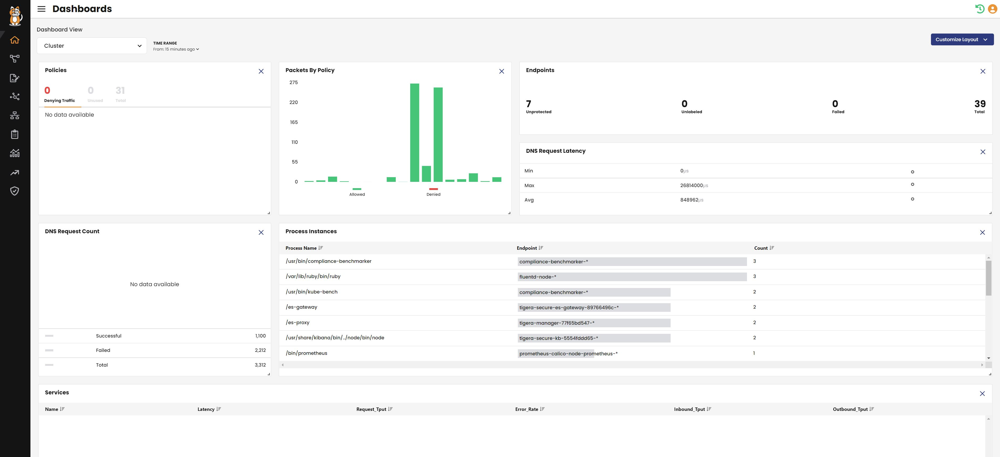
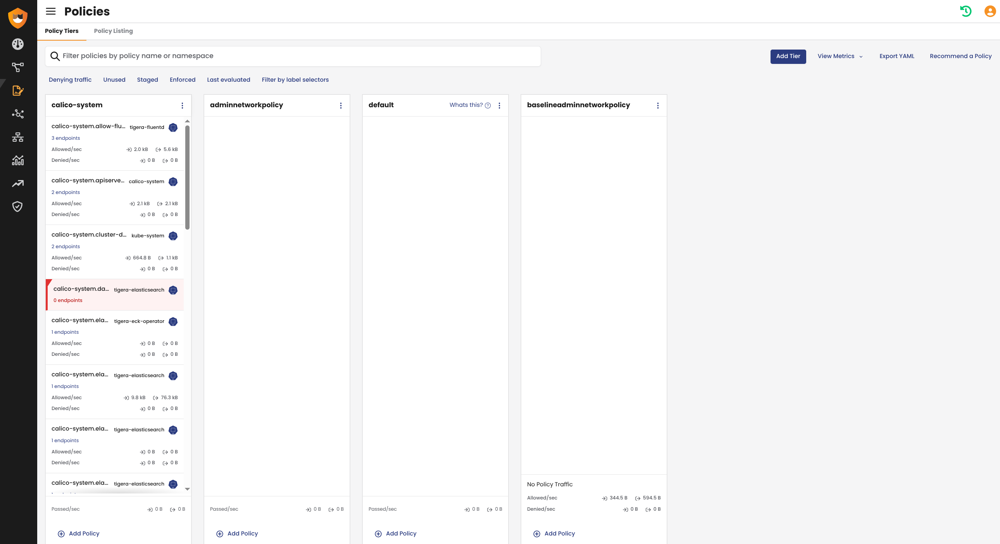
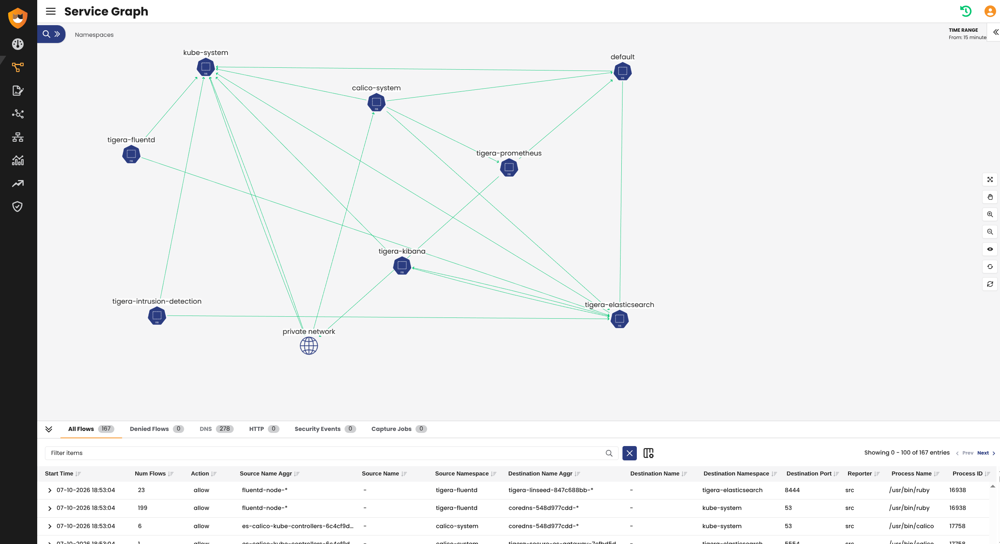
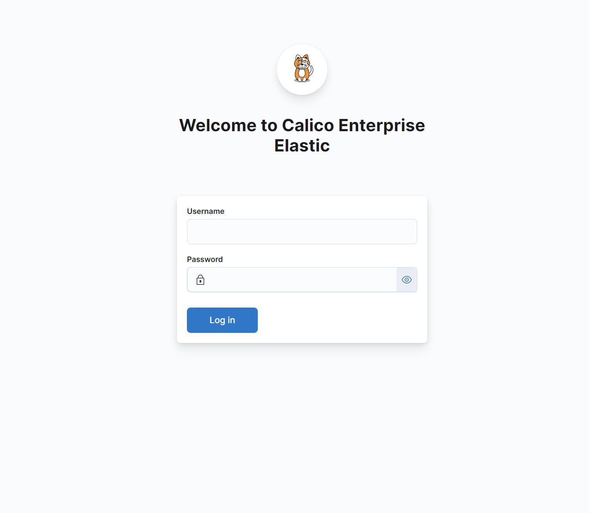

# Module 6: Calico Ingress Gateway

## In this lab

This lab provides the instructions to:

* [Overview](#overview)
* [Before you start](#before-you-start)
* [Enable Calico Ingress Gateway](#enable-calico-ingress-gateway)
* [Pattern 1 — TLS passthrough: Manager UI](#pattern-1--tls-passthrough-manager-ui)
* [Pattern 2 — TLS termination: yaobank](#pattern-2--tls-termination-yaobank)
* [Guardrail checks](#guardrail-checks)
* [Pattern 3 — HTTP to HTTPS redirect](#pattern-3--http-to-https-redirect)
* [Pattern 4 — Canary 90/10](#pattern-4--canary-9010)
* [Wrap up](#wrap-up)

---

## Overview

You enable **Calico Ingress Gateway** and build **one shared Gateway**, `calico-ingress-shared`, then add four traffic patterns to it. Envoy runs in **host-network mode** on the two worker nodes; the AWS load balancer forwards port 443 to them, and `*.<LABNAME>.training.tigera.ca` resolves to that load balancer.

```text
browser / curl ─► AWS LB :443 ─► worker :443 ─┬─ listener manager  TLS passthrough ─► TLSRoute  ─► Manager UI    (calico-system)
                                              └─ listener yaobank  HTTPS terminate ─► HTTPRoute ─► yaobank       (yaobank)
bastion (curl)  ──────────────► worker :80  ─── listener http     HTTP            ─► HTTPRoute ─► 301 to https  (calico-ingress)
```

Every step ends with **Validate**. Compare your output with the expected output before you move on.

All commands run on the **bastion**.

### The teams in this lab

In real clusters, ingress is shared by different teams with different jobs. The platform team runs the front door; application teams decide how their own traffic is routed. Gateway API is built around this split, and in this lab you play all of the roles. The first word of each command shows who is acting:

| Role | Command | Owns | What they do in this lab |
|---|---|---|---|
| **You**, cluster admin | `kubectl` | The cluster | Enable Calico Ingress Gateway, expose the Manager UI (Pattern 1), create the teams' namespaces and give the teams their permissions |
| **Paul**, platform team | `paul` | The shared Gateway (`calico-ingress`) and the TLS certificates (`calico-ingress-certs`) | Add the yaobank listener, its certificate and ReferenceGrant (Pattern 2), and the HTTP to HTTPS redirect (Pattern 3) |
| **Dana**, yaobank developer | `dana` | The yaobank application and its routes (`yaobank`) | Deploy yaobank and its HTTPRoute (Pattern 2), and run the canary release (Pattern 4) |

Paul and Dana are not real accounts. `paul` and `dana` are shortcuts for `kubectl --as=paul --as-group=platform-team` and `kubectl --as=dana --as-group=yaobank-dev`: Kubernetes runs the command **as that person** and checks it against their RBAC permissions. A command outside their job fails with `Forbidden`, exactly as it would for a real teammate.

Paul and Dana make the changes. Checking the results is not part of their job, so you always do it yourself, even in a step that starts with **Role: Dana** or **Role: Paul**:

- The status shortcuts `gw_listeners` and `route_status` use plain `kubectl`, so they run with your cluster admin permissions. Don't put `paul` or `dana` in front of them.
- The `curl` tests are ordinary HTTP requests from the bastion to the Gateway. They don't go through the Kubernetes API, so RBAC doesn't apply to them.

Each step starts with a line showing whose turn it is, for example:

> **Role: Dana (yaobank developer)**

After finishing this lab, you should understand how to enable Calico Ingress Gateway and use the Gateway API to expose applications safely through one shared Gateway.

---

## Before you start

Three one-time steps on the bastion.

### 1. Set your lab name

Every hostname in this lab ends in `<LABNAME>.training.tigera.ca`. Save your lab instance name in a variable; the commands and manifests below use `${LABNAME}`, so you never edit them by hand. The first command also saves it in `~/.bashrc`, so it is still set if you open a new terminal or reconnect.

Run this line on its own, not pasted together with anything else: it prompts for the name, and whatever line follows it in a paste would be taken as the answer. Type your lab instance name and press Enter. The name must be a single DNS label (lower-case letters, digits and hyphens, no dots): anything else is refused with a message, and running the line again replaces the saved value.

```bash
read -r -p 'Lab instance name: ' LABNAME && [[ "$LABNAME" =~ ^[a-z0-9-]+$ ]] && sed -i '/^export LABNAME=/d' ~/.bashrc && echo "export LABNAME='${LABNAME}'" >> ~/.bashrc || echo 'Nothing saved: the name must be lower-case letters, digits and hyphens only. Run this line again.'
```

Now load it and check it:

```bash
source ~/.bashrc
grep '^export LABNAME=' ~/.bashrc
echo "manager.${LABNAME}.training.tigera.ca"
```

The last command should print your Manager UI hostname, for example `manager.mylab.training.tigera.ca`, with your lab name in the middle rather than an empty label.

> [!NOTE]
> If a command later fails with a hostname such as `manager..training.tigera.ca` (two dots), `LABNAME` is empty in your shell. Run `source ~/.bashrc`; if the hostname is still wrong, nothing was saved, so run the line in step 1 again. The `source ~/.bashrc` fix also applies if `gw_listeners`, `route_status`, `paul` or `dana` reports `command not found`.

### 2. Add two status shortcuts

Throughout the lab you check whether the Gateway accepted your configuration. That information is in the `status` of the Gateway and the routes, deep inside their YAML. Run the block below: it creates two shortcut commands that print just the fields you need, one line each, and saves them in `~/.bashrc` so they are still available in a new terminal. You don't need to read the `kubectl` query inside it.

```bash
cat >> ~/.bashrc <<'EOF'
gw_listeners() {
  kubectl -n calico-ingress get gateway calico-ingress-shared -o jsonpath='{range .status.listeners[*]}{.name}{": attachedRoutes="}{.attachedRoutes}{"  Programmed="}{.conditions[?(@.type=="Programmed")].status}{"  ResolvedRefs="}{.conditions[?(@.type=="ResolvedRefs")].status}{" ("}{.conditions[?(@.type=="ResolvedRefs")].reason}{")\n"}{end}'
}
route_status() {
  kubectl -n "$1" get "$2" "$3" -o jsonpath='{range .status.parents[*]}{"Accepted="}{.conditions[?(@.type=="Accepted")].status}{" ("}{.conditions[?(@.type=="Accepted")].reason}{")  ResolvedRefs="}{.conditions[?(@.type=="ResolvedRefs")].status}{" ("}{.conditions[?(@.type=="ResolvedRefs")].reason}{")\n"}{end}'
}
EOF
source ~/.bashrc
```

How to use them:

| Shortcut | What it tells you | Example line it prints |
|---|---|---|
| `gw_listeners` | For each listener on the shared Gateway: how many routes are attached, whether it is live (`Programmed`), and whether its certificate is found (`ResolvedRefs`) | `yaobank: attachedRoutes=1  Programmed=True  ResolvedRefs=True (ResolvedRefs)` |
| `route_status <namespace> <kind> <name>` | For one route: whether the listener accepted it (`Accepted`) and whether its backend Service is found (`ResolvedRefs`) | `Accepted=True (Accepted)  ResolvedRefs=True (ResolvedRefs)` |

`True` everywhere means the step worked. A `False` is followed by the reason in brackets, such as `(RefNotPermitted)` or `(NotAllowedByListeners)`: that is what the lab asks you to look for in the guardrail steps.

### 3. Add the Paul and Dana shortcuts

Create the `paul` and `dana` commands described in [The teams in this lab](#the-teams-in-this-lab), and save them in `~/.bashrc`:

```bash
cat >> ~/.bashrc <<'EOF'
alias paul='kubectl --as=paul --as-group=platform-team'
alias dana='kubectl --as=dana --as-group=yaobank-dev'
EOF
source ~/.bashrc
```

Paul and Dana have no permissions yet. You give them their permissions at the start of Pattern 2.

---

## Enable Calico Ingress Gateway

> **Role: You (cluster admin)**

### 1. Create the namespace

`calico-ingress` holds the platform team's ingress objects: the EnvoyProxy, the Gateway and the Envoy pods.

```bash
kubectl create namespace calico-ingress
```

### 2. Enable the Gateway API

The `GatewayAPI` resource (it must be named `default`) tells the Tigera operator to install the Gateway API and Envoy Gateway CRDs and to create the GatewayClass `tigera-gateway-class`, using the EnvoyProxy you create in the next step.

```yaml
kubectl apply -f - <<EOF
apiVersion: operator.tigera.io/v1
kind: GatewayAPI
metadata:
  name: default
spec:
  gatewayClasses:
  - name: tigera-gateway-class
    gatewayKind: DaemonSet           # must match the EnvoyProxy (envoyDaemonSet) in step 4
    envoyProxyRef:
      namespace: calico-ingress
      name: envoy-hostnet
EOF
```

**Validate** (the CRDs exist; `DEGRADED=True` is expected until step 4):

```bash
kubectl get crd envoyproxies.gateway.envoyproxy.io gatewayclasses.gateway.networking.k8s.io
kubectl get tigerastatus gatewayapi
```

### 3. Confirm the worker nodes carry the worker role label

The `EnvoyProxy` in the next step pins the Envoy DaemonSet to nodes that carry the `node-role.kubernetes.io/worker` label. kubeadm does not add that label by itself; the lab image is expected to, so confirm it before you continue.

```bash
kubectl get nodes -l node-role.kubernetes.io/worker
```

You must see both worker nodes. If the command returns `No resources found`, label every node that is not a control-plane node and run the check again:

```bash
kubectl label nodes -l '!node-role.kubernetes.io/control-plane' node-role.kubernetes.io/worker=
kubectl get nodes -l node-role.kubernetes.io/worker
```

Without this label no Envoy pod is scheduled, and every `curl` in this module and in module 7 fails with a connection error.

### 4. Create the host-network EnvoyProxy

The `EnvoyProxy` says **how** Envoy runs: as a DaemonSet on the worker nodes, on the host network, binding listener ports such as 443 and 80 directly on each node.

```yaml
kubectl apply -f - <<EOF
apiVersion: gateway.envoyproxy.io/v1alpha1
kind: EnvoyProxy
metadata:
  name: envoy-hostnet
  namespace: calico-ingress
spec:
  provider:
    type: Kubernetes
    kubernetes:
      useListenerPortAsContainerPort: true
      envoyDaemonSet:
        patch:
          type: StrategicMerge
          value:
            spec:
              template:
                spec:
                  hostNetwork: true
                  dnsPolicy: ClusterFirstWithHostNet
                  # Run the Envoy data-plane DaemonSet on worker nodes only.
                  nodeSelector:
                    node-role.kubernetes.io/worker: ""
                  containers:
                  - name: envoy
                    securityContext:
                      runAsUser: 0
                      runAsGroup: 0
                      runAsNonRoot: false
                      allowPrivilegeEscalation: true
                      capabilities:
                        add: ["NET_BIND_SERVICE"]
EOF
```

**Validate** (the operator finished; the GatewayClass is accepted):

```bash
kubectl get tigerastatus gatewayapi
kubectl -n calico-system get deploy envoy-gateway
kubectl get gatewayclass
```

**Example output:**

```text
NAME                   CONTROLLER                                      ACCEPTED   AGE
tigera-gateway-class   gateway.envoyproxy.io/gatewayclass-controller   True       30s
```

---

## Pattern 1 — TLS passthrough: Manager UI

> **Role: You (cluster admin)**

The Manager UI terminates its own TLS, so Envoy routes by **SNI only** and never decrypts.

### 1. Create the Gateway

One listener, `manager`: TLS passthrough on 443 for the Manager hostname only. It accepts TLSRoutes **only from `calico-system`**. A route in another namespace must be named by the listener: that's **explicit trust**.

```yaml
kubectl apply -f - <<EOF
apiVersion: gateway.networking.k8s.io/v1
kind: Gateway
metadata:
  name: calico-ingress-shared
  namespace: calico-ingress
spec:
  gatewayClassName: tigera-gateway-class
  listeners:
  - name: manager
    protocol: TLS
    port: 443
    hostname: "manager.${LABNAME}.training.tigera.ca"
    tls:
      mode: Passthrough
    allowedRoutes:
      kinds:
      - kind: TLSRoute
      namespaces:
        from: Selector
        selector:
          matchLabels:
            kubernetes.io/metadata.name: calico-system
EOF
```

**Validate** (Envoy pods on both workers, pod IP = node IP; listener programmed):

```bash
kubectl -n calico-ingress get pods -o wide -l gateway.envoyproxy.io/owning-gateway-name=calico-ingress-shared
gw_listeners
```

**Example output:**

```text
manager: attachedRoutes=0  Programmed=True  ResolvedRefs=True (ResolvedRefs)
```

> [!NOTE]
> `kubectl get gateway` shows `PROGRAMMED False (AddressNotAssigned)`. That's expected in host-network mode: traffic reaches Envoy on the nodes, not through the Gateway's `LoadBalancer` Service. Use `gw_listeners` instead.

### 2. Create the TLSRoute

The route attaches to the `manager` listener (`sectionName`) and sends the Manager hostname to `calico-manager:9443`. It sits next to that Service in `calico-system`, so the backend needs no extra permission.

```yaml
kubectl apply -f - <<EOF
apiVersion: gateway.networking.k8s.io/v1
kind: TLSRoute
metadata:
  name: manager
  namespace: calico-system
spec:
  parentRefs:
  - name: calico-ingress-shared
    namespace: calico-ingress
    sectionName: manager
  hostnames:
  - "manager.${LABNAME}.training.tigera.ca"
  rules:
  - backendRefs:
    - name: calico-manager
      port: 9443
EOF
```

**Validate:**

```bash
route_status calico-system tlsroute manager
gw_listeners
curl -sk -o /dev/null -w '%{http_code}\n' https://manager.${LABNAME}.training.tigera.ca/
```

**Example output:**

```text
Accepted=True (Accepted)  ResolvedRefs=True (ResolvedRefs)
manager: attachedRoutes=1  Programmed=True  ResolvedRefs=True (ResolvedRefs)
200
```

### 3. Log in to the Manager UI

The Manager UI requires authentication, and a simple way to log in is with a service account token. The commands below create a service account (`tigercub`), give it the RBAC it needs by binding it to the `tigera-network-admin` cluster role that Calico Enterprise creates at install time, and generate a login token for it, valid for 24 hours. Copy the token; you paste it into the Manager UI login page.

```bash
kubectl create sa tigercub
kubectl create clusterrolebinding tigercub-bind --clusterrole tigera-network-admin --serviceaccount default:tigercub
kubectl create token tigercub --duration=24h
```

Open `https://manager.<LABNAME>.training.tigera.ca` in your browser and paste the token. Replace `<LABNAME>` with your lab instance name, or print the exact URL with:

```bash
echo "https://manager.${LABNAME}.training.tigera.ca"
```

The certificate warning comes from the **Manager's own certificate**, which shows that Envoy passed TLS through.

<a href="img/3.Calico-enterprise-manager-ui.JPG"></a>
### 4. Explore the Policies Board and Service Graph

Get yourself familiar with the Calico Enterprise Manager UI.

**Policies Board:** click **Policies** in the left navigation pane. The **Policy Tiers** view shows the network policies in the cluster grouped into **tiers**. Calico Enterprise evaluates tiers from left to right and the policies inside a tier from top to bottom. Each policy card shows the endpoints it applies to and its allowed and denied traffic rates. Click a policy to see its rules.

<a href="img/5.Calico-enterprise-policies-board.png"></a>
**Service Graph:** click **Service Graph** in the left navigation pane. It draws the namespaces in the cluster and the traffic between them, built from flow logs. Double-click a namespace, such as `calico-system`, to expand it and see the workloads inside. The panel at the bottom lists the flows, DNS and HTTP logs and security events behind the graph. New traffic can take a few minutes to appear.

<a href="img/6.Calico-enterprise-service-graph.png"></a>
### 5. Log in to Kibana

Kibana (user `elastic`): in the Manager UI, click **Logs** in the left navigation pane to open Kibana, then log in with `elastic` and the password printed by this command:

```bash
kubectl -n tigera-elasticsearch get secret tigera-secure-es-elastic-user -o go-template='{{.data.elastic | base64decode}}' && echo
```

<a href="img/4.Calico-enterprise-kibana.JPG"></a>
---

## Pattern 2 — TLS termination: yaobank

Envoy decrypts with the listener's certificate and routes plain HTTP to yaobank, on the **same port 443** as the Manager. The two listeners are told apart by hostname. This is where Paul and Dana start working together.

### 1. Give the two teams their permissions

> **Role: You (cluster admin)**

Create the two teams' namespaces and give each team permissions for its own job only:

* **Paul** may manage Gateways and HTTPRoutes in `calico-ingress`, and Secrets and ReferenceGrants in `calico-ingress-certs`.
* **Dana** may manage the application and its HTTPRoutes in `yaobank`, and may only **read** the Gateway in `calico-ingress`, to check that the route is attached.

Gateway API resources are not part of Kubernetes' built-in `edit` and `admin` roles, so each team gets its own Role.

```yaml
kubectl apply -f - <<EOF
# Namespaces the two teams work in (only an admin can create namespaces)
apiVersion: v1
kind: Namespace
metadata:
  name: yaobank
---
apiVersion: v1
kind: Namespace
metadata:
  name: calico-ingress-certs
---
# Paul (platform team): owns the shared Gateway and the platform's own routes
apiVersion: rbac.authorization.k8s.io/v1
kind: Role
metadata:
  name: platform-gateway-admin
  namespace: calico-ingress
rules:
- apiGroups: ["gateway.networking.k8s.io"]
  resources: ["gateways", "httproutes"]
  verbs: ["get", "list", "watch", "create", "update", "patch", "delete"]
---
apiVersion: rbac.authorization.k8s.io/v1
kind: RoleBinding
metadata:
  name: platform-team
  namespace: calico-ingress
subjects:
- kind: Group
  name: platform-team
  apiGroup: rbac.authorization.k8s.io
roleRef:
  kind: Role
  name: platform-gateway-admin
  apiGroup: rbac.authorization.k8s.io
---
# Paul (platform team): owns the TLS certificates and decides who may use them
apiVersion: rbac.authorization.k8s.io/v1
kind: Role
metadata:
  name: platform-certs-admin
  namespace: calico-ingress-certs
rules:
- apiGroups: [""]
  resources: ["secrets"]
  verbs: ["get", "list", "watch", "create", "update", "patch", "delete"]
- apiGroups: ["gateway.networking.k8s.io"]
  resources: ["referencegrants"]
  verbs: ["get", "list", "watch", "create", "update", "patch", "delete"]
---
apiVersion: rbac.authorization.k8s.io/v1
kind: RoleBinding
metadata:
  name: platform-team
  namespace: calico-ingress-certs
subjects:
- kind: Group
  name: platform-team
  apiGroup: rbac.authorization.k8s.io
roleRef:
  kind: Role
  name: platform-certs-admin
  apiGroup: rbac.authorization.k8s.io
---
# Dana (yaobank developer): owns the yaobank application and its routes
apiVersion: rbac.authorization.k8s.io/v1
kind: Role
metadata:
  name: yaobank-developer
  namespace: yaobank
rules:
- apiGroups: [""]
  resources: ["services", "serviceaccounts"]
  verbs: ["get", "list", "watch", "create", "update", "patch", "delete"]
- apiGroups: [""]
  resources: ["pods", "endpoints"]
  verbs: ["get", "list", "watch"]
- apiGroups: ["apps"]
  resources: ["deployments", "replicasets"]
  verbs: ["get", "list", "watch", "create", "update", "patch", "delete"]
- apiGroups: ["gateway.networking.k8s.io"]
  resources: ["httproutes"]
  verbs: ["get", "list", "watch", "create", "update", "patch", "delete"]
---
apiVersion: rbac.authorization.k8s.io/v1
kind: RoleBinding
metadata:
  name: yaobank-dev
  namespace: yaobank
subjects:
- kind: Group
  name: yaobank-dev
  apiGroup: rbac.authorization.k8s.io
roleRef:
  kind: Role
  name: yaobank-developer
  apiGroup: rbac.authorization.k8s.io
---
# Dana can read (not change) the shared Gateway, to check that her route is attached
apiVersion: rbac.authorization.k8s.io/v1
kind: Role
metadata:
  name: gateway-viewer
  namespace: calico-ingress
rules:
- apiGroups: ["gateway.networking.k8s.io"]
  resources: ["gateways"]
  verbs: ["get", "list", "watch"]
---
apiVersion: rbac.authorization.k8s.io/v1
kind: RoleBinding
metadata:
  name: yaobank-dev
  namespace: calico-ingress
subjects:
- kind: Group
  name: yaobank-dev
  apiGroup: rbac.authorization.k8s.io
roleRef:
  kind: Role
  name: gateway-viewer
  apiGroup: rbac.authorization.k8s.io
EOF
```

**Validate.** Each team can do its own job, and nothing else:

```bash
paul auth can-i update gateways -n calico-ingress            # Paul changes the shared Gateway
paul auth can-i create httproutes -n yaobank                 # Paul writes Dana's routes
dana auth can-i create httproutes -n yaobank                 # Dana writes the yaobank routes
dana auth can-i update gateways -n calico-ingress            # Dana changes the shared Gateway
dana auth can-i get secrets -n calico-ingress-certs          # Dana reads the TLS certificate
```

**Example output:**

```text
yes
no
yes
no
no
```

### 2. Deploy yaobank

> **Role: Dana (yaobank developer)**

Dana deploys the same application as in earlier modules, into the `yaobank` namespace you just created. `customer` is `ClusterIP`: the Gateway is the only way in.

```yaml
dana apply -f - <<EOF
apiVersion: v1
kind: Service
metadata:
  name: database
  namespace: yaobank
  labels:
    app: database
spec:
  ports:
  - port: 2379
    name: http
  selector:
    app: database
---
apiVersion: v1
kind: ServiceAccount
metadata:
  name: database
  namespace: yaobank
  labels:
    app: yaobank
---
apiVersion: apps/v1
kind: Deployment
metadata:
  name: database
  namespace: yaobank
spec:
  replicas: 1
  selector:
    matchLabels:
      app: database
      version: v1
  template:
    metadata:
      labels:
        app: database
        version: v1
    spec:
      serviceAccountName: database
      containers:
      - name: database
        image: calico/yaobank-database:certification
        imagePullPolicy: IfNotPresent
        ports:
        - containerPort: 2379
        command: ["etcd"]
        args:
          - "-advertise-client-urls"
          - "http://database:2379"
          - "-listen-client-urls"
          - "http://0.0.0.0:2379"
---
apiVersion: v1
kind: Service
metadata:
  name: summary
  namespace: yaobank
  labels:
    app: summary
spec:
  ports:
  - port: 80
    name: http
  selector:
    app: summary
---
apiVersion: v1
kind: ServiceAccount
metadata:
  name: summary
  namespace: yaobank
  labels:
    app: yaobank
    database: reader
---
apiVersion: apps/v1
kind: Deployment
metadata:
  name: summary
  namespace: yaobank
spec:
  replicas: 2
  selector:
    matchLabels:
      app: summary
      version: v1
  template:
    metadata:
      labels:
        app: summary
        version: v1
    spec:
      serviceAccountName: summary
      containers:
      - name: summary
        image: calico/yaobank-summary:certification
        imagePullPolicy: Always
        ports:
        - containerPort: 80
---
apiVersion: v1
kind: Service
metadata:
  name: customer
  namespace: yaobank
  labels:
    app: customer
spec:
  ports:
  - port: 80
    name: http
  selector:
    app: customer
---
apiVersion: v1
kind: ServiceAccount
metadata:
  name: customer
  namespace: yaobank
  labels:
    app: yaobank
    summary: reader
---
apiVersion: apps/v1
kind: Deployment
metadata:
  name: customer
  namespace: yaobank
spec:
  replicas: 1
  selector:
    matchLabels:
      app: customer
      version: v1
  template:
    metadata:
      labels:
        app: customer
        version: v1
    spec:
      serviceAccountName: customer
      containers:
      - name: customer
        image: calico/yaobank-customer:certification
        imagePullPolicy: Always
        ports:
        - containerPort: 80
EOF
```

**Validate** (four pods `Running`):

```bash
dana -n yaobank get pods,svc
```

### 3. Create the wildcard certificate

> **Role: Paul (platform team)**

Paul keeps the platform's certificates in their own namespace, `calico-ingress-certs`. One self-signed wildcard certificate covers every app hostname in the lab.

```bash
openssl req -x509 -nodes -days 365 -newkey rsa:2048 -keyout tls.key -out tls.crt \
  -subj "/CN=*.${LABNAME}.training.tigera.ca" \
  -addext "subjectAltName=DNS:*.${LABNAME}.training.tigera.ca"
paul -n calico-ingress-certs create secret tls wildcard-tls --cert=tls.crt --key=tls.key --dry-run=client -o yaml | paul apply -f -
rm -f tls.key
```

The private key now lives only in the Secret; the last line removes the copy on the bastion. Keep `tls.crt`, the later `curl --cacert tls.crt` checks use it. The `--dry-run=client -o yaml | apply` form means the block is safe to run again: a re-run replaces the Secret with the newly generated pair instead of failing with `AlreadyExists`, so `tls.crt` on disk always matches what the Gateway serves.

### 4. Add the yaobank listener

> **Role: Paul (platform team)**

The new listener `yaobank` uses HTTPS with `Terminate` and the certificate from `calico-ingress-certs`. It serves the yaobank hostname only and accepts routes only from the `yaobank` namespace, so Dana can attach routes to it and nobody else can.

```yaml
paul apply -f - <<EOF
apiVersion: gateway.networking.k8s.io/v1
kind: Gateway
metadata:
  name: calico-ingress-shared
  namespace: calico-ingress
spec:
  gatewayClassName: tigera-gateway-class
  listeners:
  - name: manager
    protocol: TLS
    port: 443
    hostname: "manager.${LABNAME}.training.tigera.ca"
    tls:
      mode: Passthrough
    allowedRoutes:
      kinds:
      - kind: TLSRoute
      namespaces:
        from: Selector
        selector:
          matchLabels:
            kubernetes.io/metadata.name: calico-system
  - name: yaobank
    protocol: HTTPS
    port: 443
    hostname: "yaobank.${LABNAME}.training.tigera.ca"
    tls:
      mode: Terminate
      certificateRefs:
      - name: wildcard-tls
        namespace: calico-ingress-certs
    allowedRoutes:
      namespaces:
        from: Selector
        selector:
          matchLabels:
            kubernetes.io/metadata.name: yaobank
EOF
```

**Validate:**

```bash
gw_listeners
```

**Example output:**

```text
manager: attachedRoutes=1  Programmed=True  ResolvedRefs=True (ResolvedRefs)
yaobank: attachedRoutes=0  Programmed=False  ResolvedRefs=False (RefNotPermitted)
```

The certificate is in another namespace and its owner hasn't agreed to share it. **Nothing crosses a namespace boundary until the other side says yes.**

### 5. Allow it with a ReferenceGrant

> **Role: Paul (platform team)**

As the owner of `calico-ingress-certs`, Paul lets Gateways in `calico-ingress` use `wildcard-tls`, and nothing else. This is explicit trust.

```yaml
paul apply -f - <<EOF
apiVersion: gateway.networking.k8s.io/v1
kind: ReferenceGrant
metadata:
  name: allow-calico-ingress-gateways
  namespace: calico-ingress-certs
spec:
  from:
  - group: gateway.networking.k8s.io
    kind: Gateway
    namespace: calico-ingress
  to:
  - group: ""
    kind: Secret
    name: wildcard-tls
EOF
```

**Validate** (`yaobank: … Programmed=True  ResolvedRefs=True`):

```bash
gw_listeners
```

### 6. Create the HTTPRoute

> **Role: Dana (yaobank developer)**

Paul's listener is ready. Dana now decides how yaobank traffic is routed: the route attaches to the `yaobank` listener and sends the yaobank hostname to `customer:80`. Dana does not need to touch the Gateway.

```yaml
dana apply -f - <<EOF
apiVersion: gateway.networking.k8s.io/v1
kind: HTTPRoute
metadata:
  name: yaobank
  namespace: yaobank
spec:
  parentRefs:
  - name: calico-ingress-shared
    namespace: calico-ingress
    sectionName: yaobank
  hostnames:
  - "yaobank.${LABNAME}.training.tigera.ca"
  rules:
  - backendRefs:
    - name: customer
      port: 80
EOF
```

**Validate:**

```bash
route_status yaobank httproute yaobank
curl -s --cacert tls.crt -o /dev/null -w '%{http_code}\n' https://yaobank.${LABNAME}.training.tigera.ca/
```

**Example output:**

```text
Accepted=True (Accepted)  ResolvedRefs=True (ResolvedRefs)
200
```

### 7. Open yaobank in your browser

Open `https://yaobank.<LABNAME>.training.tigera.ca` in your browser. Replace `<LABNAME>` with your lab instance name, or print the exact URL with:

```bash
echo "https://yaobank.${LABNAME}.training.tigera.ca"
```

Your browser warns about the certificate because it is self-signed. Accept the warning to continue. This time the warning is about **your wildcard certificate**, served by the Gateway, not the application's own. You should see the yaobank customer page.

> [!NOTE]
> The yaobank `customer` service only serves plain HTTP on port 80, yet your connection is encrypted. TLS runs from your browser, across the public Internet and through the AWS load balancer, all the way to the Gateway's Envoy pod on the worker node. Envoy decrypts it there, then forwards the request as plain HTTP to the `customer` pod inside the cluster. The application gets HTTPS without any change to its code or configuration.

### 8. Compare termination with passthrough

`curl --cacert tls.crt` succeeds only if the Gateway served **your** certificate. Compare the two hostnames (yaobank shows your wildcard certificate; manager shows the Manager's own):

```bash
for h in manager yaobank; do echo "== $h"; openssl s_client -connect $h.${LABNAME}.training.tigera.ca:443 -servername $h.${LABNAME}.training.tigera.ca </dev/null 2>/dev/null | openssl x509 -noout -subject -issuer; done
```

---

## Guardrail checks

Try four things the platform should block: two that Paul's listeners block, and two that the teams' RBAC blocks. Read the result of each, then delete the test routes.

### 1. Wrong hostname

> **Role: Dana (yaobank developer)**

Dana's new route asks for `shop.…`, but the listener serves only `yaobank.…`, so there is no overlap.

```yaml
dana apply -f - <<EOF
apiVersion: gateway.networking.k8s.io/v1
kind: HTTPRoute
metadata:
  name: shop
  namespace: yaobank
spec:
  parentRefs:
  - name: calico-ingress-shared
    namespace: calico-ingress
    sectionName: yaobank
  hostnames:
  - "shop.${LABNAME}.training.tigera.ca"
  rules:
  - backendRefs:
    - name: customer
      port: 80
EOF
```

```bash
route_status yaobank httproute shop
```

**Example output:**

```text
Accepted=False (NoMatchingListenerHostname)  ResolvedRefs=True (ResolvedRefs)
```

### 2. Untrusted namespace

> **Role: You, acting as another team** (neither Paul nor Dana can create anything in `default`)

A route in `default` tries to attach to the yaobank listener and use the yaobank Service.

```yaml
kubectl apply -f - <<EOF
apiVersion: gateway.networking.k8s.io/v1
kind: HTTPRoute
metadata:
  name: hijack
  namespace: default
spec:
  parentRefs:
  - name: calico-ingress-shared
    namespace: calico-ingress
    sectionName: yaobank
  rules:
  - backendRefs:
    - name: customer
      namespace: yaobank
      port: 80
EOF
```

```bash
route_status default httproute hijack
```

**Example output:**

```text
Accepted=False (NotAllowedByListeners)  ResolvedRefs=False (RefNotPermitted)
```

Both sides refused, independently: the listener doesn't trust `default`, and no ReferenceGrant in `yaobank` shares the Service.

### 3. Dana changes the shared Gateway

> **Role: Dana (yaobank developer)**

Dana tries to delete the shared Gateway. `--dry-run=server` is a safety net: even if the permissions were wrong, nothing would be deleted. The permission check still runs.

```bash
dana -n calico-ingress delete gateway calico-ingress-shared --dry-run=server
```

**Example output:**

```text
Error from server (Forbidden): gateways.gateway.networking.k8s.io "calico-ingress-shared" is forbidden: User "dana" cannot delete resource "gateways" in API group "gateway.networking.k8s.io" in the namespace "calico-ingress"
```

### 4. Dana reads the TLS certificate

> **Role: Dana (yaobank developer)**

```bash
dana -n calico-ingress-certs get secret wildcard-tls
```

**Example output:**

```text
Error from server (Forbidden): secrets "wildcard-tls" is forbidden: User "dana" cannot get resource "secrets" in API group "" in the namespace "calico-ingress-certs"
```

Dana uses the platform's certificate through the listener, but can never read its private key.

Delete the two test routes:

```bash
dana -n yaobank delete httproute shop
kubectl -n default delete httproute hijack
```

---

## Pattern 3 — HTTP to HTTPS redirect

### 1. Add the http listener

> **Role: Paul (platform team)**

Redirecting every application to HTTPS is a platform-wide decision, so Paul does it once for everyone. The `http` listener on port 80 has no `allowedRoutes`, so the default `from: Same` applies. Only routes in `calico-ingress` can attach: **implicit trust**.

```yaml
paul apply -f - <<EOF
apiVersion: gateway.networking.k8s.io/v1
kind: Gateway
metadata:
  name: calico-ingress-shared
  namespace: calico-ingress
spec:
  gatewayClassName: tigera-gateway-class
  listeners:
  - name: manager
    protocol: TLS
    port: 443
    hostname: "manager.${LABNAME}.training.tigera.ca"
    tls:
      mode: Passthrough
    allowedRoutes:
      kinds:
      - kind: TLSRoute
      namespaces:
        from: Selector
        selector:
          matchLabels:
            kubernetes.io/metadata.name: calico-system
  - name: yaobank
    protocol: HTTPS
    port: 443
    hostname: "yaobank.${LABNAME}.training.tigera.ca"
    tls:
      mode: Terminate
      certificateRefs:
      - name: wildcard-tls
        namespace: calico-ingress-certs
    allowedRoutes:
      namespaces:
        from: Selector
        selector:
          matchLabels:
            kubernetes.io/metadata.name: yaobank
  - name: http
    protocol: HTTP
    port: 80
EOF
```

**Validate** (`http: attachedRoutes=0  Programmed=True …`):

```bash
gw_listeners
```

### 2. Create the redirect route

> **Role: Paul (platform team)**

`sectionName: http` keeps HTTPS traffic from looping. The route has no `backendRefs`, because Envoy answers itself: 301 to `https://` on port 443.

```yaml
paul apply -f - <<EOF
apiVersion: gateway.networking.k8s.io/v1
kind: HTTPRoute
metadata:
  name: https-redirect
  namespace: calico-ingress
spec:
  parentRefs:
  - name: calico-ingress-shared
    sectionName: http
  hostnames:
  - "*.${LABNAME}.training.tigera.ca"
  rules:
  - filters:
    - type: RequestRedirect
      requestRedirect:
        scheme: https
        statusCode: 301
EOF
```

**Validate** the route, and store the IP of a worker node running Envoy. The AWS load balancer forwards only port 443, so you test port 80 against a worker IP directly:

```bash
route_status calico-ingress httproute https-redirect
WORKER_IP=$(kubectl -n calico-ingress get pods -l gateway.envoyproxy.io/owning-gateway-name=calico-ingress-shared -o jsonpath='{.items[0].status.hostIP}')
echo ${WORKER_IP}
```

**Example output:**

```text
Accepted=True (Accepted)  ResolvedRefs=True (ResolvedRefs)
10.0.1.31
```

The IP is one of the two worker nodes (`10.0.1.30` or `10.0.1.31`); either works.

**Request 1: plain HTTP on port 80.** `--connect-to` sends the request to the worker's port 80 while keeping the real hostname in it:

```bash
curl -sI --connect-to yaobank.${LABNAME}.training.tigera.ca:80:${WORKER_IP}:80 http://yaobank.${LABNAME}.training.tigera.ca/ | grep -i '^HTTP/\|^location'
```

**Example output:**

```text
HTTP/1.1 301 Moved Permanently
location: https://yaobank.<LABNAME>.training.tigera.ca/
```

**Envoy answers this request itself.** The client did not ask for a redirect: it sent an ordinary request for `http://yaobank…` on port 80. The redirect is the platform team's choice: the gateway does not serve applications over plain, unencrypted HTTP, so instead of refusing the request it tells the client to come back over HTTPS on port 443.

Here is how that works: the request matches the `https-redirect` route in `calico-ingress`. The route's only rule has a `RequestRedirect` filter and no `backendRefs`, so there is nothing to forward the request to. Envoy Gateway programs that rule in Envoy as a **redirect** instead of a forward to a backend. Envoy builds the `301` response on the spot and sends it straight back to the client, so yaobank never sees the request. The `location` header only tells the client where to go next: Envoy builds it from the request's own hostname and path, with the scheme changed to `https`. The route does not reference yaobank, its namespace or its Service.

**Request 2: follow the redirect.** `-L` makes curl follow the `location` header:

```bash
curl -sIL --cacert tls.crt --connect-to yaobank.${LABNAME}.training.tigera.ca:80:${WORKER_IP}:80 http://yaobank.${LABNAME}.training.tigera.ca/ | grep -i '^HTTP/'
```

**Example output:**

```text
HTTP/1.1 301 Moved Permanently
HTTP/2 200
```

The first line is the same `301` from Envoy. curl then opens a **new** HTTPS connection to `https://yaobank.<LABNAME>…` on port 443, through the AWS load balancer. That request matches the `yaobank` listener and the `yaobank` HTTPRoute, and **yaobank answers with `200`**. It shows `HTTP/2` because curl and Envoy agree on HTTP/2 over HTTPS.

> [!NOTE]
> **Is it normal for the gateway in `calico-ingress` to reach an app in `yaobank`?** Yes. Namespaces separate configuration, not traffic, and one shared gateway serving apps in many namespaces is the whole idea. Envoy only routes to yaobank because the `yaobank` listener accepts routes from the `yaobank` namespace (Pattern 2). Without that, request 1 would still get its `301`, but request 2 would get `404 Not Found`.

---

## Pattern 4 — Canary 90/10

> **Role: Dana (yaobank developer)**

Releasing a new version is the application team's job. Dana runs the whole canary release with the HTTPRoute alone, without asking Paul for any change.

### 1. Deploy customer v2

Same image, separate Deployment and Service.

```yaml
dana apply -f - <<EOF
apiVersion: v1
kind: Service
metadata:
  name: customer-v2
  namespace: yaobank
  labels:
    app: customer-v2
spec:
  ports:
  - port: 80
    name: http
  selector:
    app: customer-v2
---
apiVersion: apps/v1
kind: Deployment
metadata:
  name: customer-v2
  namespace: yaobank
spec:
  replicas: 1
  selector:
    matchLabels:
      app: customer-v2
      version: v2
  template:
    metadata:
      labels:
        app: customer-v2
        version: v2
    spec:
      serviceAccountName: customer
      containers:
      - name: customer
        image: calico/yaobank-customer:certification
        imagePullPolicy: Always
        ports:
        - containerPort: 80
EOF
```

**Validate** (`customer-v2` pod `Running`):

```bash
dana -n yaobank get pods -l app=customer-v2
```

### 2. Split 90/10

Two weighted `backendRefs`. Each one sets an `x-version` response header, so you can see which version answered.

```yaml
dana apply -f - <<EOF
apiVersion: gateway.networking.k8s.io/v1
kind: HTTPRoute
metadata:
  name: yaobank
  namespace: yaobank
spec:
  parentRefs:
  - name: calico-ingress-shared
    namespace: calico-ingress
    sectionName: yaobank
  hostnames:
  - "yaobank.${LABNAME}.training.tigera.ca"
  rules:
  - backendRefs:
    - name: customer
      port: 80
      weight: 90
      filters:
      - type: ResponseHeaderModifier
        responseHeaderModifier:
          set:
          - name: x-version
            value: v1
    - name: customer-v2
      port: 80
      weight: 10
      filters:
      - type: ResponseHeaderModifier
        responseHeaderModifier:
          set:
          - name: x-version
            value: v2
EOF
```

Before you count, make sure both versions are ready to receive traffic. If you test too early, every request goes to v1 and the split looks wrong:

```bash
# Wait until the customer-v2 pod is Ready (returns once the rollout is complete)
dana -n yaobank rollout status deployment/customer-v2

# The route with the new weights must be accepted
route_status yaobank httproute yaobank
```

**Example output:**

```text
deployment "customer-v2" successfully rolled out
Accepted=True (Accepted)  ResolvedRefs=True (ResolvedRefs)
```

Then send 300 requests and count which version answered each one:

```bash
for i in $(seq 1 300); do
  curl -s --cacert tls.crt -o /dev/null -D - https://yaobank.${LABNAME}.training.tigera.ca/ | grep -i '^x-version' | tr -d '\r'
done | sort | uniq -c
```

**Example output:**

```text
    271 x-version: v1
     29 x-version: v2
```

**Why the numbers are not exactly 90/10.** Envoy picks the backend for **each request** at random, using the weights as proportions (`weight ÷ sum of weights`), like rolling a 10-sided die for every request. Over a small number of requests the result wanders around the target: with 100 requests, anything from about 85/15 to 95/5 is normal, and with 300 requests it stays closer to 90/10. Run the loop again and the numbers change a little each time. If `v2` never appears, check the two commands above: the `customer-v2` pod is not ready yet, or the route update has not been accepted.

### 3. Promote and roll back

Change only the weights, and rerun the loop after each patch. Envoy applies the change live, with no pod restart.

```bash
# 50/50
dana -n yaobank patch httproute yaobank --type=json -p='[{"op":"replace","path":"/spec/rules/0/backendRefs/0/weight","value":50},{"op":"replace","path":"/spec/rules/0/backendRefs/1/weight","value":50}]'
for i in $(seq 1 300); do
  curl -s --cacert tls.crt -o /dev/null -D - https://yaobank.${LABNAME}.training.tigera.ca/ | grep -i '^x-version' | tr -d '\r'
done | sort | uniq -c
```

```bash
# 0/100 (promote v2)
dana -n yaobank patch httproute yaobank --type=json -p='[{"op":"replace","path":"/spec/rules/0/backendRefs/0/weight","value":0},{"op":"replace","path":"/spec/rules/0/backendRefs/1/weight","value":100}]'
for i in $(seq 1 300); do
  curl -s --cacert tls.crt -o /dev/null -D - https://yaobank.${LABNAME}.training.tigera.ca/ | grep -i '^x-version' | tr -d '\r'
done | sort | uniq -c
```

```bash
# 100/0 (roll back to v1)
dana -n yaobank patch httproute yaobank --type=json -p='[{"op":"replace","path":"/spec/rules/0/backendRefs/0/weight","value":100},{"op":"replace","path":"/spec/rules/0/backendRefs/1/weight","value":0}]'
for i in $(seq 1 300); do
  curl -s --cacert tls.crt -o /dev/null -D - https://yaobank.${LABNAME}.training.tigera.ca/ | grep -i '^x-version' | tr -d '\r'
done | sort | uniq -c
```

---

## Wrap up

Remove the canary only. **Keep** the Gateway, the Manager route and yaobank: later modules use them.

> **Role: Dana (yaobank developer)**

```yaml
dana apply -f - <<EOF
apiVersion: gateway.networking.k8s.io/v1
kind: HTTPRoute
metadata:
  name: yaobank
  namespace: yaobank
spec:
  parentRefs:
  - name: calico-ingress-shared
    namespace: calico-ingress
    sectionName: yaobank
  hostnames:
  - "yaobank.${LABNAME}.training.tigera.ca"
  rules:
  - backendRefs:
    - name: customer
      port: 80
EOF
```

```bash
dana -n yaobank delete deployment customer-v2
dana -n yaobank delete service customer-v2
```

**Validate** (three listeners with one route each; yaobank answers):

```bash
gw_listeners
curl -s --cacert tls.crt -o /dev/null -w '%{http_code}\n' https://yaobank.${LABNAME}.training.tigera.ca/
```

**Example output:**

```text
manager: attachedRoutes=1  Programmed=True  ResolvedRefs=True (ResolvedRefs)
yaobank: attachedRoutes=1  Programmed=True  ResolvedRefs=True (ResolvedRefs)
http: attachedRoutes=1  Programmed=True  ResolvedRefs=True (ResolvedRefs)
200
```

> [!WARNING]
> Never delete the `GatewayAPI` resource, the `EnvoyProxy` or the `calico-ingress` namespace to clean up. That removes the front door for the Manager UI and every application behind it.

### Revoke the Manager UI login

The `tigercub` service account from Pattern 1 holds the `tigera-network-admin` role, and its token is valid for 24 hours. Remove both now that you are done with the Manager UI. If you need the UI again later, recreate them with the three commands in Pattern 1.

```bash
kubectl delete clusterrolebinding tigercub-bind
kubectl delete sa tigercub
```

> **Congratulations! You have completed `6. Calico Ingress Gateway` lab.**

---

[← Previous: 5. Calico Enterprise Egress Gateway](../5.Calico-Enterprise-Egress-Gateway/README.md) | [Training overview](../README.md) | [Next: 7. Implement Calico Enterprise eBPF →](../7.Implement-Calico-Enterprise-eBPF/README.md)
